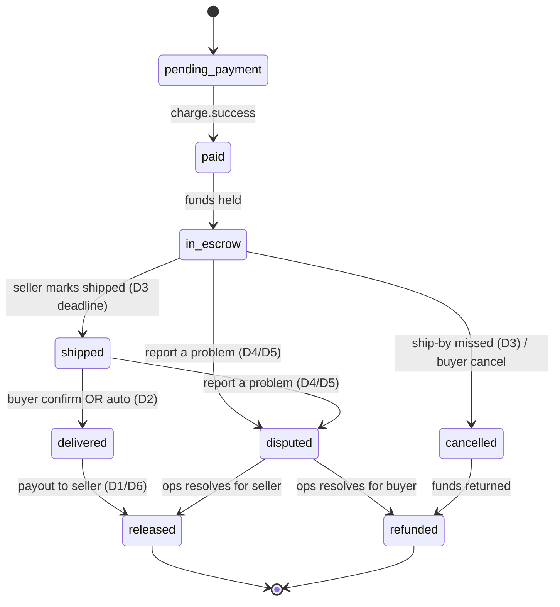

# Escrow policy (ADR-11)

**Status:** Accepted (2026-07-24) · **Go/no-go:** [`PHASE3_GO_NO_GO.md`](../team/PHASE3_GO_NO_GO.md) C1 · **Work split:** [`PHASE3_WORK_SPLIT.md`](../team/PHASE3_WORK_SPLIT.md)

This ADR pins the escrow numbers and rails every Phase 3 track builds on: hold/release windows, refund + dispute route, payout rail, fees, and the multi-seller decision. These are the values Phase 3 is built against — the state machine (Shannon), payout (Felix), and timers (Brian) all read them from one canonical config module (see [Config](#config)), so a change here propagates everywhere.

---

## Context

Phase 2 leaves money and goods disconnected: the buyer pays, an order row exists, but nothing holds funds until the buyer has the item, and nothing moves funds to the seller or reverses them. Phase 3 adds an escrow-style hold. To build it we must first agree the policy, because the same numbers appear in the DB migration, the state-machine transitions, the payout call, and the timer jobs.

---

## Decisions

Values marked *(configurable)* are read from the [Config](#config) module and can be changed via env without a code change.

| # | Decision | Policy | Rationale | Consumed by |
|---|----------|--------|-----------|-------------|
| D1 | **Release trigger** | Buyer taps **Confirm receipt** → release immediately | Buyer control is the core trust promise | Shannon (state machine), Felix (payout) |
| D2 | **Auto-release window** | **7 days** *(configurable)* after `shipped` (or `delivered`) with no buyer action → auto-release | Protects sellers from silent non-confirmers; long enough for real delivery | Brian (timers) |
| D3 | **Ship-by deadline** | Seller must mark `shipped` within **3 days** *(configurable)* of `paid`, else auto-cancel + full refund | Stops funds sitting in limbo when a seller ghosts | Brian (timers), Felix (refund) |
| D4 | **Refund / dispute window** | Buyer may **report a problem** any time before release (i.e. during the hold) | Refunds only make sense while funds are still held | Shannon (buyer UI), Felix (refund) |
| D5 | **Dispute route (v1)** | Report a problem → status `disputed`, **pauses** auto-release timer, routes to **manual ops** (email/admin). No automated adjudication | Keeps v1 shippable; humans resolve edge cases | Felix, ops |
| D6 | **Payout rail** | Paystack **Transfers after release** (not subaccounts) | Subaccounts settle at charge time, which breaks escrow; transfers let us hold then pay on release | Felix (C-CORE-4) |
| D7 | **Platform commission** | **10%** *(configurable)* of item price, deducted from seller payout | Platform revenue on a completed sale | Felix (payout math) |
| D8 | **Paystack processing fee** | Absorbed by **platform** (not passed to buyer/seller) | Simpler checkout math; revisit at scale | Shannon (totals), Felix (payout) |
| D9 | **Multi-seller checkout (v1)** | **Single-seller checkout only.** The cart may hold several sellers; the buyer checks out **one seller per order** and the rest stay in the cart. An order mixing sellers is **blocked** (not split) | Avoids one-payment→N-escrows complexity without forcing buyers to discard items | John (C-CORE-8), Shannon (cart) |
| D10 | **Reminders** | Nudge buyer to confirm at **day 3 and day 6**; nudge seller to ship at **day 2** *(configurable)* | Reduces auto-resolutions and support load | Brian (timers/notifications) |
| D11 | **Refund amount** | Refunds during the hold return **100%** of what the buyer paid (item price + any VAT/shipping). Commission (D7) is **only** taken at release, so a refunded sale earns nothing; the platform absorbs the non-returnable Paystack fee (D8). Partial refunds only via manual ops on a dispute (D5) | Commission exists only on a completed sale; a reversed sale must make the buyer whole | Felix (refund), Shannon (buyer UI) |
| D12 | **Escrowed amount vs payout base** | **Escrow holds the full captured charge** (item subtotal + **16% VAT** *(configurable)*). The **payout base is the item subtotal only** — VAT is never paid out to the seller. `payments.amount_minor` means *what the provider captured*, nothing else | Follows from D7 and D11 rather than adding policy: D7 takes commission on **item price**, and D11 cannot return 100% of what the buyer paid unless escrow holds it | John (order creation, reconciliation), Felix (payout, refund) |

---

### D12 in practice

This one exists because the code contradicted D7 and D11 for a while, so the consequence is spelled out.

**What the buyer pays.** Checkout charges `subtotal + VAT`. That is what Paystack captures and therefore what escrow holds.

**What gets recorded.** [`createOrder`](../../backend/services/ordersService.ts) writes `subtotal + VAT` to `payments.amount_minor`. C-CORE-6a reconciliation overwrites it from Paystack Verify, which is the authority. Recording anything else guarantees a permanent mismatch and hides the real ones.

**What the seller is paid.** `calculatePayout(itemPriceMinor)` takes 10% off whatever it is handed, so it must be handed the **line-item subtotal**, derived from `order_items.total_price`.

> Never pass `payments.amount_minor` into `calculatePayout`. It includes VAT the platform owes to KRA, so the seller would be paid a share of tax and the platform would be short.

**What a refund returns.** The full `amount_minor`, which is now the full capture — satisfying D11 without the caller having to reconstruct the VAT.

**Where the rate lives.** `VAT_RATE` in [`packages/contracts/src/pricing.ts`](../../packages/contracts/src/pricing.ts), shared by the cart and the BFF, overridable server-side via `ESCROW_VAT_RATE`. Overriding it makes the cart's displayed figure an estimate; Verify remains authoritative.

---

## State machine (target)



**Invariants:** payment is the only source of the `paid` transition (webhook, single writer); a seller can only drive `shipped`; a buyer can only drive `delivered`/`disputed`; a `disputed` order pauses all auto timers (D2) until ops resolves.

---

## Config

The tunable values (D2, D3, D7, D10) live in **one canonical module** so the state machine, payout, and timers never hardcode them. This follows the existing env-driven pattern in [`backend/handlers/payments/config.ts`](../../backend/handlers/payments/config.ts) validated by [`configValidator.ts`](../../backend/payments/configValidator.ts).

```ts
// backend/payments/escrowPolicy.ts (canonical source of truth)
export const escrowPolicy = {
  autoReleaseDays: Number(process.env.ESCROW_AUTO_RELEASE_DAYS ?? 7),   // D2
  shipByDays:      Number(process.env.ESCROW_SHIP_BY_DAYS ?? 3),        // D3
  commissionRate:  Number(process.env.ESCROW_COMMISSION_RATE ?? 0.10),  // D7
  vatRate:         Number(process.env.ESCROW_VAT_RATE ?? VAT_RATE),     // D12
  buyerReminderDays: [3, 6],                                            // D10
  sellerReminderDays: [2],                                              // D10
} as const;
```

| Env var | Maps to | Default | Validation |
|---------|---------|---------|------------|
| `ESCROW_AUTO_RELEASE_DAYS` | D2 | `7` | integer, `> shipByDays` |
| `ESCROW_SHIP_BY_DAYS` | D3 | `3` | integer, `> 0` |
| `ESCROW_COMMISSION_RATE` | D7 | `0.10` | number, `0 ≤ x < 1` |
| `ESCROW_VAT_RATE` | D12 | `0.16` | number, `0 ≤ x < 1` |

`vatRate` defaults from `VAT_RATE` in [`packages/contracts/src/pricing.ts`](../../packages/contracts/src/pricing.ts) so the cart and the BFF cannot drift. Overriding it server-side makes the cart's figure an estimate.

**Rules:** every consumer imports `escrowPolicy` — no inline `7`/`3`/`0.10`; `configValidator` fails fast at boot on an out-of-range value; changing a window or the rate is an env edit + restart, **not** a code change. A future `platform_settings` DB table (runtime edits, no restart) is the upgrade path if non-engineers ever need to tune these live — out of scope for v1.

---

## Trade-offs / alternatives considered

| Area | Chosen | Alternative | Why not the alternative |
|------|--------|-------------|-------------------------|
| Payout rail (D6) | Transfers after release | Subaccounts (split at charge) | Subaccounts settle immediately → no true hold; can't reverse cleanly on dispute |
| Auto-release (D2) | 7 days | No auto-release (manual only) | Funds deadlock forever if buyer never confirms |
| Dispute (D5) | Manual ops | Automated adjudication | Too much scope for v1; low volume expected |
| Multi-seller (D9) | Multi-seller cart, single-seller checkout | Split one payment into N escrows | Big schema + payout complexity; defer until volume justifies |
| Fees (D7/D8) | Fixed 10%, platform absorbs Paystack fee | Pass fees to buyer | Cleaner UX now; revisit when margins matter |

---

## Consequences

- **Unblocks** C-CORE-1 (schema needs these states + timestamps), C-CORE-2 (transitions), C-CORE-4 (transfers rail), C-CORE-7 (timer values).
- **Requires** Paystack **Transfers** capability + verified recipients (KYC, C-CORE-9) — start enablement day 1; transfers are gated on a funded balance and approved recipients.
- **Deferred:** automated disputes, multi-seller splitting, buyer-paid fees, courier/tracking integration.

---

## Follow-ups (non-blocking)

These don't block Phase 3 build against D1–D12, but should be closed before **live** funds move:

1. Business ratifies the **10% commission** (D7) and fee absorption (D8); tune via `ESCROW_COMMISSION_RATE` if it changes.
2. Confirm the **7-day / 3-day** windows (D2/D3) hold up against real Kenya delivery times; tune via env if not.
3. Revisit **single-seller v1** (D9) once volume justifies payment splitting.
4. Legal review of **escrow / buyer-protection terms** copy before holding real funds.
5. Confirm VAT remittance treatment with whoever owns tax (D12). The platform holds the VAT through escrow and pays it out to nobody; that assumes the platform is the party remitting it.

Accepted 2026-07-24 and registered in [`ADR.md`](./ADR.md) (ADR-11). D1–D11 are frozen for the phase; tunable values change via [Config](#config).

**D12 added 2026-08-12.** Not a new policy — it records what D7 and D11 already required, after the code was found to contradict both. See [D12 in practice](#d12-in-practice).
