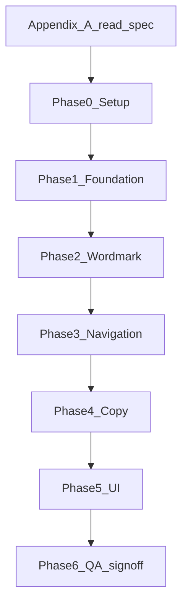

# Landing page ↔ RN app brand alignment

**Status:** Implemented in `landing/` (July 2026) — manual screenshot QA (LND-25/26, 60–65, 67–68) pending  
**Source of truth:** `apps/mobile` (this monorepo)  
**Target:** [`landing/`](../../landing/) in this monorepo (Next.js 15)  
**Branch:** `fix/landing-rn-brand-alignment`  
**Direction:** Landing page aligns **to** the React Native app (not the reverse).

---

## How to use this doc

1. Read [Appendix A — Canonical brand spec](#appendix-a--canonical-brand-spec) before touching landing CSS.
2. From repo root: `npm run dev:landing` (or `npm run dev --prefix landing`).
3. Work tasks in sprint order: Setup → Foundation → Wordmark → Navigation → Copy → UI → QA.
4. Mark checkboxes in your IDE as you complete each item.
5. List closed task IDs (e.g. `LND-20`, `LND-40`) in your PR description.
6. Run side-by-side QA: landing (desktop + mobile web) vs RN app auth and Home screens.

**PR template snippet:**

```markdown
## Brand alignment closed
- LND-01, LND-02, … (list all)

## Screenshots
- Header wordmark vs app TopNav
- Hero vs app LandingScreen
- Primary CTA vs app GradientButton
```

---

## Product decisions (locked)

Do not re-debate these during the build sprint.

| Topic | Decision |
|-------|----------|
| Brand direction | Landing follows RN app |
| Primary font | **Outfit** (Google Fonts) — weights 400, 500, 600, 700, 900 |
| Editorial monospace on landing | **Remove or demote** — RN app does not use monospace labels; use Outfit uppercase micro-labels instead |
| Primary accent | Mint green `#48CD8A` (CTAs, active states, key metrics) |
| Warm accent | `#F2B872` for taglines/eyebrows only (not every section header) |
| Nav labels | Align to app tabs: **Home · Discover · Sell · Stylist · Me** (replace Closet / Resale / Sustainability) |
| Hero promise | Match auth landing copy, not magazine-editorial headline |
| Waitlist CTA | Keep; style as RN `GradientButton` (green gradient, dark uppercase label) |
| Logo | Text wordmark **LUKU** only (no indigo/purple gradient logo from old web) |

---

## Sprint order



---

## Prerequisites

### In this monorepo

```bash
# Repo root — landing dev server
npm install --prefix landing
npm run dev:landing

# Side-by-side QA — mobile app
npm run dev:mobile
```

Open these screens on device/simulator while building landing:

| Screen | Path in app |
|--------|-------------|
| Splash | Auth → Splash |
| Auth landing | Auth → Landing |
| In-app header | Home tab → TopNav |
| Primary CTA | Auth → Landing → Join Free pill |
| Wardrobe stats | Wardrobe item detail → Cost Per Wear row |

### Landing app setup (`landing/`)

- [x] **LND-00** Landing lives in monorepo at `landing/`
- [x] **LND-00a** Branch `fix/landing-rn-brand-alignment`
- [x] **LND-00b** Root script `npm run dev:landing` runs local dev

---

## Phase 0 — Setup (`landing/`)

- [x] **LND-01** Add Outfit via Google Fonts or `@fontsource/outfit` for weights 400, 500, 600, 700, 900
- [x] **LND-02** Create CSS variables or Tailwind theme mirroring [Appendix A](#appendix-a--canonical-brand-spec)
- [x] **LND-03** Remove or disable landing monospace editorial font if present

### Suggested CSS variables (copy into landing repo)

```css
:root {
  --luku-bg-shell: #000000;
  --luku-text-on-dark: #ffffff;
  --luku-text-muted: rgba(255, 255, 255, 0.6);
  --luku-text-subtle: rgba(255, 255, 255, 0.5);
  --luku-text-cream: #f7f3ee;
  --luku-text-primary: #0a0a0a;
  --luku-accent-primary: #48cd8a;
  --luku-accent-bright: #3ab87a;
  --luku-accent-warm: #f2b872;
  --luku-border-dark: rgba(255, 255, 255, 0.1);
  --luku-card-dark: rgba(255, 255, 255, 0.05);
  --luku-input-dark: rgba(255, 255, 255, 0.06);
  --luku-radius-xl: 16px;
  --luku-radius-pill: 999px;
  --luku-font: 'Outfit', system-ui, sans-serif;
}
```

---

## Phase 1 — Foundation

- [x] **LND-10** Set page background to `#000000`
- [x] **LND-11** Map all greens to `#48CD8A` / `#3AB87A` gradient pair
- [x] **LND-12** Map gold/tan labels to `#F2B872` (warm accent only)
- [x] **LND-13** Standardize card border: `1px rgba(255,255,255,0.1)`, radius `16px`
- [x] **LND-14** Primary button matches RN `GradientButton`:
  - Background: linear gradient `#48CD8A` → `#3AB87A` (135deg)
  - Label: `#0A0A0A`, Outfit 900, `13px`, uppercase, `letter-spacing: 0.125em`
  - Padding: `16px` vertical; radius `12px` (`radii.lg`)
- [x] **LND-15** Secondary/outline buttons: `1px rgba(255,255,255,0.1)` border, `rgba(255,255,255,0.05)` fill
- [x] **LND-16** Text inputs (waitlist): bg `rgba(255,255,255,0.06)`, border `rgba(255,255,255,0.1)`

---

## Phase 2 — Logo / wordmark

The RN app uses inline text wordmarks (no SVG logo). Landing must match these **locked variants**.

### Wordmark variant spec

| Variant | Context | Font | Size | Letter-spacing | Color | RN reference |
|---------|---------|------|------|----------------|-------|--------------|
| `wordmark-hero` | Hero on full-bleed photo | Outfit 900 | 96px desktop (scale 72–96) | `-0.04em` | `#F7F3EE` cream | `apps/mobile/src/screens/auth/LandingScreen.tsx` |
| `wordmark-nav` | Sticky header | Outfit 900 | 28px | `-0.035em` | `#FFFFFF` | `apps/mobile/src/components/shell/TopNav.tsx` |
| `wordmark-auth` | Sign-in/up overlay (if used) | Outfit 900 | 56px | `-0.035em` | `#F7F3EE` cream | `apps/mobile/src/screens/auth/SignInScreen.tsx` |
| `wordmark-splash` | Reference only | Outfit 900 | 80px | `-0.0375em` | cream | `apps/mobile/src/screens/auth/SplashScreen.tsx` |

### Logo rules

- Always **LUKU** in all caps; never “Luku” in UI
- Never stretch, outline, shadow, or apply gradient to the wordmark text
- Nav wordmark uses `wordmark-nav` — **not** the oversized hero size
- Tagline beside/below wordmark uses **warm accent** (`#F2B872`), uppercase, wide tracking

### Tagline spec (beside hero wordmark)

Match auth landing tagline row:

- Small horizontal rule: `24px × 1px`, `#F2B872`
- Tagline text: `Stylist · Wardrobe · Shop`
- Font: Outfit 900, `10px`, uppercase, `letter-spacing: 0.2em`, color `#F2B872`

### Checklist

- [x] **LND-20** Header logo uses `wordmark-nav` (28px, Outfit 900, white)
- [x] **LND-21** Hero uses app headline (`Your Style. Your Wardrobe.`) + tagline row
- [x] **LND-22** Footer / waitlist section logo uses `wordmark-nav` (not hero size)
- [x] **LND-23** Remove any SVG gradient logo or sparkle mark from old web brand
- [x] **LND-24** Tagline under hero uses warm accent + uppercase tracking (not green)
- [ ] **LND-25** Screenshot diff: header wordmark vs mobile TopNav
- [ ] **LND-26** Screenshot diff: hero wordmark vs mobile LandingScreen

---

## Phase 3 — Navigation and IA

App tab bar (canonical IA):

| Tab | Label | Purpose |
|-----|-------|---------|
| Home | Home | Feed, OOTD, curated picks |
| Discover | Discover | Marketplace browse |
| Sell | Sell | List from wardrobe |
| Stylist | Stylist | AI outfit suggestions |
| Me | Me | Profile, wardrobe, commerce |

### Checklist

- [x] **LND-30** Replace nav links `Closet / Resale / Sustainability` → **Discover · Wardrobe · Sell · Stylist**
- [x] **LND-31** Header CTA → **`Join waitlist`** styled as green gradient pill
- [x] **LND-32** Update in-page anchor IDs and scroll targets for renamed sections
- [x] **LND-33** Footer nav mirrors header link labels

---

## Phase 4 — Copy realignment

Replace landing editorial/magazine voice with RN app voice. Use the table below section-by-section.

### Section copy map

| Landing section (current) | Current landing copy (remove/replace) | Replace with (RN-aligned) | Done |
|---------------------------|---------------------------------------|----------------------------|------|
| **Hero** | “Closets, edited like a magazine.” | Headline: **Your Style. Your Wardrobe.** or lead with auth body copy | [x] |
| Hero sub | “LUKU turns your wardrobe into a living editorial…” | **AI styling from your own wardrobe — then shop what completes the look.** | [x] |
| Hero tag | Small gold “LUKU” label | **Stylist · Wardrobe · Shop** (warm accent) | [x] |
| Hero CTAs | “Start your closet” / “See the ritual →” | **Join waitlist** (primary) + secondary link to How it works | [x] |
| **Feature 01** | “Photographed once. Worn forever.” | **Build your wardrobe** — Start by adding items to your digital wardrobe. Take a photo or upload from your gallery. | [x] |
| **Feature 02** | “A wardrobe that edits itself.” | **Track what you wear** — Log wears, see cost per wear, and know which pieces earn their place. | [x] |
| **Editorial note block** | “A closet that feels as thoughtful as your outfit.” | **Welcome to LUKU!** — Let's personalize your experience. (onboarding tone) | [x] |
| Metric boxes | “pieces lost to indecision” / infinity outfits | **Times Worn · Purchase Price · Cost Per Wear** (flat stat row like item detail) | [x] |
| **How it works** | “A closet ritual, refined.” | **How it works** — Four steps to style, track, and sell from one closet. | [x] |
| Card 01 | “Digital closet” | Keep title; body: photograph/import items — brand, size, condition, searchable | [x] |
| Card 02 | “Outfit builder” | **Stylist** — AI-powered outfit suggestions from your wardrobe and marketplace | [x] |
| Card 03 | “Wear log & cost per wear” | Keep; emphasize **Log Wear** and **Cost Per Wear** labels from item detail | [x] |
| Card 04 | “Sell what you outgrow” | **List for Sale** — Your item is now live on the LUKU marketplace. One tap from wardrobe. | [x] |
| **Peer resale** | “Every piece is already styled, sized, and ready.” | Listing confirmation tone; show Active/Sold status badges | [x] |
| **Sustainability** | “The most sustainable piece…” manifesto | Wardrobe Insights tone: **Eco Impact** — CO₂ saved, rewears this month (calm, data-led) | [x] |
| **Waitlist** | “Your closet is waiting.” | Keep headline; sub: **Be first in line when LUKU opens up.** | [x] |
| Waitlist CTA | “Join waitlist” | Keep label; style as green gradient button | [x] |
| **Meta / SEO** | “Your closet, finally worth its tags” | **LUKU** — Style · Shop · Sustain (or auth landing one-liner) | [x] |

### Canonical copy snippets (copy-paste)

**Splash** (`SplashScreen.tsx`):

- Tagline: `Your Style. Your Wardrobe.`
- Caption: `Style · Shop · Sustain`

**Auth landing** (`LandingScreen.tsx`):

- Tagline: `Stylist · Wardrobe · Shop`
- Body: `AI styling from your own wardrobe — then shop what completes the look.`
- Primary CTA: `Join Free`

**Onboarding** (`OnboardingScreen.tsx`):

- Welcome: `Welcome to LUKU!`
- Sub: `Let's personalize your experience. What's your style?`
- Wardrobe step: `Build Your Wardrobe` / `Start by adding items to your digital wardrobe.`

**Onboarding complete** (`OnboardingCompleteScreen.tsx`):

- `AI-powered recommendations`
- `Personalized style matches`
- `Smart wardrobe tracking`

**Home feed** (`HomeScreen.tsx`):

- Section: `PICKED FOR YOU`
- Sub: `AI-curated recommendations based on your style and wardrobe`
- Section: `TRENDING NOW`

**Wardrobe item detail** (`WardrobeItemDetailScreen.tsx`):

- CTA: `Log Wear` / `Wear Logged`
- Stats: `Times Worn`, `Purchase Price`, `Cost Per Wear`
- Action: `List for Sale`

**Listing confirmation** (`ListingConfirmationScreen.tsx`):

- `Listing Published!`
- `Your item is now live on the LUKU marketplace.`

### Copy checklist

- [x] **LND-40** Hero copy pass
- [x] **LND-41** Features copy pass
- [x] **LND-42** How-it-works copy pass
- [x] **LND-43** Resale section copy pass
- [x] **LND-44** Sustainability copy pass
- [x] **LND-45** Waitlist/footer copy pass
- [x] **LND-46** `<title>` and meta description updated (drop “Personal Style Companion” — not used in app)
- [x] **LND-47** Open Graph / Twitter card copy matches new hero

---

## Phase 5 — UI components

- [x] **LND-50** Hero stat bubbles: flat stat row (Times Worn / Cost Per Wear / Purchase Price)
- [x] **LND-51** Section labels: Outfit 900, 10px, uppercase, warm (`#F2B872`) or subtle white — **not** monospace gold
- [x] **LND-52** Headlines: Outfit 900, sentence case for H1/H2 (reserve ALL CAPS for micro-labels only)
- [x] **LND-53** Image overlays: gradient `transparent → rgba(0,0,0,0.8)` on photography
- [x] **LND-54** Remove accent colors not in RN tokens (orphan teals, unrelated oranges)
- [x] **LND-55** Reduce oversized border-radius (32px+) to `16px` for cards; hero images max `24px` if needed
- [x] **LND-56** Card/tag chips match RN: `rgba(255,255,255,0.05)` bg, subtle border
- [x] **LND-57** Price / positive metrics use `#48CD8A` (e.g. cost per wear, KES amounts)

---

## Phase 6 — QA sign-off

### Visual comparison

- [ ] **LND-60** Desktop 1440px visual pass
- [ ] **LND-61** Mobile 390px visual pass
- [ ] **LND-62** Side-by-side: landing header vs app `TopNav`
- [ ] **LND-63** Side-by-side: landing hero vs app `LandingScreen`
- [ ] **LND-64** Side-by-side: landing CTA vs app `GradientButton`
- [ ] **LND-65** Color picker spot-check: bg `#000000`, green `#48CD8A`, warm `#F2B872`, cream `#F7F3EE`
- [x] **LND-66** Font check: only Outfit loaded; no monospace in UI (code + build verified)
- [ ] **LND-67** Deploy preview reviewed on Vercel
- [ ] **LND-68** Production promote after stakeholder sign-off

### Regression guardrails

- [x] Waitlist form still submits (no broken action URL)
- [x] All nav anchor links scroll correctly
- [x] No layout shift from font swap (use `font-display: swap`)
- [x] Lighthouse: no critical contrast failures on green CTA (`#0A0A0A` on `#48CD8A`) — verify on deploy

---

## Appendix A — Canonical brand spec

Extracted from `apps/mobile/src/theme/tokens.ts`. Landing repo should mirror these values.

### Colors

| Token | Value | Landing usage |
|-------|-------|---------------|
| `background.shell` | `#000000` | Page background |
| `background.cardDark` | `rgba(255,255,255,0.05)` | Dark cards, stat tiles |
| `background.inputDark` | `rgba(255,255,255,0.06)` | Waitlist email input |
| `text.onDark` | `#FFFFFF` | Headlines, nav |
| `text.onDarkMuted` | `rgba(255,255,255,0.6)` | Body copy |
| `text.onDarkSubtle` | `rgba(255,255,255,0.5)` | Captions, micro-labels |
| `text.cream` | `#F7F3EE` | Hero wordmark on photo |
| `text.primary` | `#0A0A0A` | Text on green buttons |
| `text.secondary` | `#737373` | Rare; light surfaces only |
| `accent.primary` | `#48CD8A` | Primary CTA, badges, prices |
| `accent.bright` | `#3AB87A` | Gradient end |
| `accent.warm` | `#F2B872` | Taglines, eyebrows |
| `accent.gradientStart` | `#48CD8A` | Button gradient start |
| `accent.gradientEnd` | `#3AB87A` | Button gradient end |
| `border.dark` | `rgba(255,255,255,0.1)` | Card borders |

**Do not use on landing primary surfaces:** `accent.tryOn` (`#8A48CD`), old web indigo/purple gradient brand.

### Spacing (px)

| Token | Value |
|-------|-------|
| `xs` | 4 |
| `sm` | 8 |
| `md` | 12 |
| `lg` | 16 |
| `xl` | 24 |
| `xxl` | 32 |
| `page` | 24 (horizontal page gutter) |

### Radii (px)

| Token | Value | Notes |
|-------|-------|-------|
| `sm` | 4 | |
| `md` | 8 | |
| `lg` | 12 | Buttons |
| `xl` | 16 | Cards — **use this as landing default** |
| `pill` | 999 | Pills, FAB |

### Typography — UI roles

| Role | Font | Size | Weight | Color | Extra |
|------|------|------|--------|-------|-------|
| Page title | Outfit | 36px | 900 | white | letter-spacing -1px |
| Section title | Outfit | 22px | 900 | white | |
| Section title sm | Outfit | 14px | 900 | white | optional uppercase |
| Body | Outfit | 13–14px | 600 | muted white | line-height ~1.4 |
| Micro label | Outfit | 10px | 900 | subtle or warm | uppercase, tracking 1.5–2px |
| Button label | Outfit | 13px | 900 | `#0A0A0A` | uppercase, tracking 2px |

### Typography — LUKU wordmark (logo)

See [Phase 2 — Logo / wordmark](#phase-2--logo--wordmark) for full variant table.

### Primary button (GradientButton)

```css
.luku-btn-primary {
  background: linear-gradient(135deg, #48cd8a 0%, #3ab87a 100%);
  border-radius: 12px;
  padding: 16px 24px;
  font-family: var(--luku-font);
  font-weight: 900;
  font-size: 13px;
  letter-spacing: 0.125em;
  text-transform: uppercase;
  color: #0a0a0a;
}
```

---

## Appendix B — Landing section → mobile reference map

| Landing section | Mobile screen / component | File path |
|-----------------|---------------------------|-----------|
| Header + logo | TopNav | `apps/mobile/src/components/shell/TopNav.tsx` |
| Hero | Auth LandingScreen | `apps/mobile/src/screens/auth/LandingScreen.tsx` |
| Splash animation reference | SplashScreen | `apps/mobile/src/screens/auth/SplashScreen.tsx` |
| Primary CTA | GradientButton | `apps/mobile/src/components/auth/GradientButton.tsx` |
| Tab IA | BottomTabBar | `apps/mobile/src/components/shell/BottomTabBar.tsx` |
| Curated feed | HomeScreen | `apps/mobile/src/screens/HomeScreen.tsx` |
| Marketplace grid | DiscoverScreen | `apps/mobile/src/screens/DiscoverScreen.tsx` |
| Digital closet | WardrobeScreen | `apps/mobile/src/screens/WardrobeScreen.tsx` |
| Wear / CPW stats | WardrobeItemDetailScreen | `apps/mobile/src/screens/WardrobeItemDetailScreen.tsx` |
| AI outfits | StylistScreen | `apps/mobile/src/screens/StylistScreen.tsx` |
| List for sale | ListForSaleSheet, ListingConfirmation | `apps/mobile/src/components/sell/ListForSaleSheet.tsx` |
| Eco / sustain | WardrobeScreen Insights tab | `apps/mobile/src/screens/WardrobeScreen.tsx` |
| Onboarding voice | OnboardingScreen | `apps/mobile/src/screens/auth/OnboardingScreen.tsx` |
| Design tokens | tokens.ts | `apps/mobile/src/theme/tokens.ts` |

---

*Last updated: July 2026*
