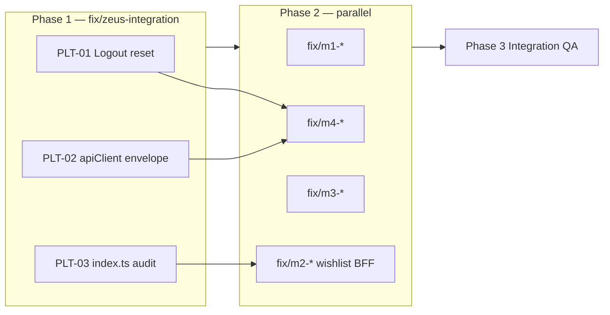

# Zeus remediation — execution plan

**Branch strategy:** Platform first, then parallel member fixes.  
**Product decisions:** Confirmed by product lead (see [ZEUS_REMEDIATION.md](./ZEUS_REMEDIATION.md) § Product decisions).  
**Tracking doc:** [ZEUS_REMEDIATION.md](./ZEUS_REMEDIATION.md)

---

## Current state (pre-branch)

| Item | Status |
|------|--------|
| M1–M4 PRs on `zeus` | Merged |
| Local uncommitted fixes | Partial PLT work on `zeus` (see below) |
| `repositories/index.ts` duplicate keys | Fixed locally — still uses `createEmptyWishlistRepository` |
| Wishlist BFF | **Not on `zeus`** — no `backend/router/v1/wishlist.ts`; M2 must ship |
| Payment routes envelope | M-Pesa / Paystack return **raw JSON**, not `ApiResponse` → checkout throws `ApiError: 201` |
| Logout → AppState reset | **Not implemented** |
| M1 logout → Sign In | **Likely OK** — `App.tsx` sets `authInitialRoute('SignIn')` when session ends |

### Local diff to fold into `fix/zeus-integration`

These changes exist on working tree `zeus` and should be **committed on the integration branch**, not lost:

- `apps/mobile/src/repositories/index.ts` — remove duplicate keys; wire API repos for outfits/listings/orders/messages/inbox
- `apps/mobile/src/api/apiClient.ts` — add `apiPut`; remove debug `console.log`
- `package.json` — remove root `react`/`react-dom` deps (fixes npm EOVERRIDE)
- Debug log cleanup in `bffWardrobe.ts`, `MeScreen.tsx`, `WardrobeScreen.tsx`

---

## Phase 0 — Prep (30 min)

**Owner:** Platform lead

1. Pull latest `zeus`:
   ```bash
   git fetch origin
   git checkout zeus
   git pull origin zeus
   ```
2. Create integration branch:
   ```bash
   git checkout -b fix/zeus-integration
   ```
3. Stage only platform-scope files from local diff (or re-apply if stashed):
   - `apps/mobile/src/api/apiClient.ts`
   - `apps/mobile/src/repositories/index.ts`
   - `apps/mobile/src/context/AppStateContext.tsx` (after PLT-01 edits)
   - `apps/mobile/src/context/AuthContext.tsx` (if listener bridge added)
   - `package.json`
   - Optional hygiene: `bffWardrobe.ts`, debug logs in screens
4. **Do not** commit member-zone screen fixes on this branch unless they are one-line platform dependencies.

**Verify before coding:**

```bash
npm install
npm run verify:deps
npm run lint:mobile
```

---

## Phase 1 — `fix/zeus-integration` (platform)

**Goal:** Close PLT-01 → PLT-03 (P0), then PLT-04 → PLT-05 if time.  
**PR target:** `zeus`  
**Estimated effort:** 0.5–1 day

### PLT-01 — Logout clears AppState (P0)

**Closes:** PLT-01, M1-08, unblocks M4-01

| Step | Action |
|------|--------|
| 1 | Add `resetSessionState()` on `AppStateContext` — clear `cartItems`, `wishlistedIds`, `wishlistItems`, `inboxUnreadCount`, `wardrobeItems`, `createdOutfits`, `inspirationOutfits`; clear AsyncStorage `luku_wishlist_ids` |
| 2 | Add `reloadSessionState()` — refetch cart (`GET /v1/api/cart`), wishlist, wardrobe, outfits, inbox unread when user logs in |
| 3 | Call `resetSessionState()` from `AuthContext.logout()` **or** subscribe in `AppStateProvider` to `user === null` |
| 4 | On login success (`login`, `verifyOtp`, OAuth), call `reloadSessionState()` |

**Files:** `AppStateContext.tsx`, `AuthContext.tsx` (minimal bridge — e.g. callback ref or event; avoid circular imports)

**Manual test:**

1. Login `dev+buyer@luku.app` → add item to cart → logout  
2. Login `dev+seller@luku.app` → cart must be **empty**  
3. Logout → login buyer again → cart restores from API for buyer

---

### PLT-02 — Checkout ApiError 201 (P0)

**Closes:** PLT-02, M4-03 (payment step), M4-04

**Root cause:** Payment handlers return raw payloads (`MpesaStkPushResponse`, Paystack charge result) without `{ success, data }`. Mobile `apiClient` treats missing `success` as failure even when `response.ok`.

| Step | Action |
|------|--------|
| 1 | In `apiClient.ts`, detect envelope: `'success' in json` |
| 2 | If **no envelope** and `response.ok`, wrap as `{ success: true, data: json, ... }` |
| 3 | If envelope and `!json.success`, throw as today |
| 4 | Retest M-Pesa STK push (201) and Paystack charge (200) from Cart |

**Alternative (not preferred):** Wrap payment routes in `createResponse()` on backend — larger diff, touches M4 zone.

**Manual test:**

1. Cart → checkout → M-Pesa → no `ApiError: 201` in console  
2. Order creation proceeds to `repositories.orders.create`  
3. Step advances to `complete`; cart cleared

---

### PLT-03 — `repositories/index.ts` audit (P0)

**Closes:** PLT-03; partial M2-01

| Key | Integration mode (`USE_MOCK_DATA=false`) |
|-----|------------------------------------------|
| products | `createApiProductsRepository` ✓ |
| profile, connections, userProfile | `createApi*` ✓ |
| wardrobe, outfits, listings | `createApi*` ✓ |
| inbox, messages, orders, notifications | `createApi*` ✓ |
| wishlist | **`createEmptyWishlistRepository`** until M2 ships API |
| stylist, wardrobePairings, discoverCatalog, home | `createEmpty*` (expected) |

| Step | Action |
|------|--------|
| 1 | Confirm single object literal — no duplicate keys |
| 2 | Add comment block documenting expected wiring (from ZEUS_REMEDIATION merge zones) |
| 3 | **Do not** wire `createApiWishlistRepository` here without backend — defer to `fix/m2-catalog-qa` |

---

### PLT-04 — Vitest react resolution (P1)

**Closes:** M4 checklist §1

| Step | Action |
|------|--------|
| 1 | Run `npm test` / backend handler tests; capture react resolution error |
| 2 | Add `resolve.dedupe: ['react', 'react-dom']` or alias in `vitest.config.ts` |
| 3 | Confirm root `package.json` overrides-only for react (already in local diff) |

---

### PLT-05 — Remove dev console.log (P2)

| Step | Action |
|------|--------|
| 1 | Grep `apps/mobile/src` for `console.log` |
| 2 | Remove or gate behind `__DEV__` where needed for debugging |

---

### Phase 1 PR checklist

```markdown
## Remediation PR — Platform (fix/zeus-integration)

Closes: PLT-01, PLT-02, PLT-03, PLT-04, PLT-05

### Manual QA
- [ ] Logout/login cart isolation (buyer vs seller)
- [ ] M-Pesa checkout no longer throws on 201
- [ ] Card checkout path reaches order create
- [ ] `npm run lint:mobile` passes
- [ ] `npm run verify:deps` passes

### Regression
- [ ] Wardrobe/outfits/listings still load (API repos wired)
- [ ] Inbox threads still load
```

**Merge `fix/zeus-integration` → `zeus` before member P0 branches rebase.**

---

## Phase 2 — Parallel member branches (after platform merge)

Each member branches from **updated `zeus`**. Work in parallel; resolve `repositories/index.ts` conflicts in order: platform → M2 (wishlist) only.

### `fix/m1-auth-profile-qa` — John

| Priority | IDs | Key work |
|----------|-----|----------|
| P0 | M1-01, M1-02 | Profile photo refresh on Me; verify logout → Sign In (may already pass) |
| P1 | M1-03–M1-05 | OTP unconfirmed route, password reset, seller UserProfile from product detail |
| P2 | M1-06, M1-07 | Connections tally, blocked-user seeds |

**Product tie-in:** None beyond consuming PLT-01 logout reset.

---

### `fix/m2-catalog-qa` — Brian

| Priority | IDs | Key work |
|----------|-----|----------|
| P0 | M2-01 | **Ship wishlist BFF** (`wishlist.ts`, `wishlistService.ts`, `bffWishlist.ts`, `createApiWishlistRepository`) + wire in `index.ts` |
| P1 | M2-02–M2-05 | Discover pagination, wishlist sync, **add-to-cart snackbar (no navigate to Cart)**, duplicate React keys |
| P2 | M2-06 | BrandDetail / StyleDetail API feeds |

**Product tie-in:** M2-04 implements confirmed decision — remove `navigation.navigate('Cart')` in `ProductDetailScreen.tsx`; use `ToastContext`.

**Blocker note:** M2-01 is larger than a wiring fix; backend routes are missing on `zeus` today.

---

### `fix/m3-wardrobe-sell-qa` — Felix

| Priority | IDs | Key work |
|----------|-----|----------|
| P0 | M3-01–M3-05 | Duplicate listing guard, resume listing, hide/badge listed wardrobe items, return-to-wardrobe sync, mark sold persistence |
| P1 | M3-06–M3-13 | Loading UX, description display, photo slots honesty, outfit picker, double-tap guards, remix seed |

**Product tie-in:** M3-03 implements **listed items in wardrobe** — hide or badge Active; do not delete wardrobe row.

---

### `fix/m4-commerce-inbox-qa` — Shannon

| Priority | IDs | Key work |
|----------|-----|----------|
| P0 | M4-01–M4-03 | Cart isolation (verify after PLT-01), delete line + clear cart + qty min 1, checkout E2E |
| P1 | M4-05–M4-08 | Hide shipping methods + buyer-delivery copy, inbox UI polish, remove fake “active now”, Stylist → AI API |
| P2 | M4-09, M4-10 | Orders grouping, card checkout full pass |

**Product tie-in:**

- M4-02 — qty min 1; explicit Remove (no qty → 0 decrement)
- M4-05 — hide express/standard; escrow copy only this sprint

---

## Phase 3 — Integration QA (all branches merged)

**When:** All P0 PRs on `zeus`.

| Step | Action |
|------|--------|
| 1 | Re-run all member QA checklists (M1–M4 docs) |
| 2 | Cross-user regression: buyer cart, seller listings, inbox thread |
| 3 | Update [ZEUS_REMEDIATION.md](./ZEUS_REMEDIATION.md) sign-off table |
| 4 | Log deferred P1/P2 to backlog with BL-* IDs where applicable |

**Smoke script (15 min):**

1. Register/login → Me profile photo  
2. Discover → product detail → add to cart (stays on page, badge updates)  
3. Cart → checkout M-Pesa → order in Commerce  
4. Wardrobe → list item → badge/hide in grid → mark sold  
5. Inbox → send message → unread badge  
6. Logout → Sign In → empty cart for next user  

---

## Dependency graph



---

## Suggested timeline

| Day | Work |
|-----|------|
| D0 | Phase 0 prep + open `fix/zeus-integration` |
| D1 | PLT-01–03 implement, test, PR merge to `zeus` |
| D1–D3 | M1, M2, M3, M4 parallel P0 branches |
| D4 | P1 polish where capacity allows |
| D5 | Phase 3 integration QA + sign-off |

---

## Out of scope (backlog)

Do not implement on remediation branches:

- BL-01 Recommendation engine  
- BL-02 Escrow payment flow  
- BL-03 Multi-photo galleries  
- BL-05 Peer listing auto-sold on purchase  
- BL-06 Replace Gemini on catalog rails  

See [ZEUS_REMEDIATION.md § Backlog](./ZEUS_REMEDIATION.md#backlog-after-remediation-sign-off).
