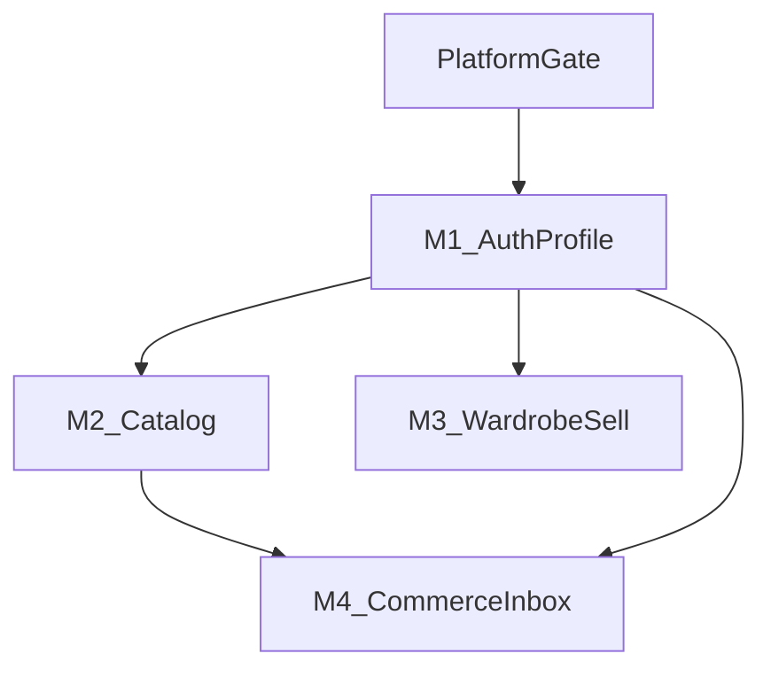

# Phase 2 spec distribution

> **Current work:** See **[`TEAM_ROADMAP.md`](./TEAM_ROADMAP.md)**, **[`PHASE0_STATUS.md`](./PHASE0_STATUS.md)**, and **[`TEAM_GO_CHECKLIST.md`](./TEAM_GO_CHECKLIST.md)** (John smoke findings). This doc remains valid for dev setup and kickoff agenda.

**Gate:** Complete [`00_PLATFORM_GATE.md`](./00_PLATFORM_GATE.md) before assigning work.

## Read order (all members)

1. [`../architecture/ADR.md`](../architecture/ADR.md)
2. [`../architecture/BFF_OVERVIEW.md`](../architecture/BFF_OVERVIEW.md)
3. [`../database/TABLE_SCOPE.md`](../database/TABLE_SCOPE.md) — **what not to build against**
4. [`../api/CONTRACT_MATRIX.md`](../api/CONTRACT_MATRIX.md)
5. [`LEGACY_REFERENCE_GUIDE.md`](./LEGACY_REFERENCE_GUIDE.md)
6. Your member spec (`01`–`04`)
7. [`PR_CHECKLIST.md`](./PR_CHECKLIST.md)

## Dev setup (shared)

```bash
# Repo root
cp .env.example .env.local   # add SUPABASE_SERVICE_ROLE_KEY from dashboard
npm install
npm run db:seed              # if fresh dev DB
npm run dev:api

# Mobile (separate terminal)
cd apps/mobile
# .env: EXPO_PUBLIC_USE_MOCK_DATA=false, EXPO_PUBLIC_API_BASE_URL=http://<LAN-IP>:3001
npm run start
```

**Data modes:** `USE_MOCK_DATA=true` = full offline UI for designers; `false` = integration mode — live BFF for shipped domains, skeleton/empty elsewhere until your endpoints land. See [`../../apps/mobile/docs/MOCK_DATA_POLICY.md`](../../apps/mobile/docs/MOCK_DATA_POLICY.md).

**Seed logins:** [`database/seeds/dev_seed.sql`](../../database/seeds/dev_seed.sql) (password `LukuDev2026!`).

**Verify gate:** `npm run verify:gate` (API must be running).

## Assignment table

| Member | Spec | Owner | Start | Depends on |
|--------|------|-------|-------|------------|
| M1 | [`01_MEMBER_AUTH_PROFILE.md`](./01_MEMBER_AUTH_PROFILE.md) | John | Phase 0 | Gate sign-off |
| M2 | [`02_MEMBER_CATALOG.md`](./02_MEMBER_CATALOG.md) | Brian | Phase 0 | Platform PR on `zeus` |
| M3 | [`03_MEMBER_WARDROBE_SELL.md`](./03_MEMBER_WARDROBE_SELL.md) | Felix | Phase 0 | Platform PR on `zeus` |
| M4 | [`04_MEMBER_COMMERCE_INBOX.md`](./04_MEMBER_COMMERCE_INBOX.md) | Shannon | Phase 0 | Platform PR on `zeus` |



## Kickoff agenda (30 min)

1. BFF pattern demo: SignIn → `GET /v1/api/products` (seed data)
2. Walk `TABLE_SCOPE.md` — `trips` / `business_accounts` / `listings` vs `products`
3. Contract matrix + PR checklist
4. Q&A per member spec

## Sign-off

| Field | Value |
|-------|-------|
| Gate approved by | John (platform lead) |
| Date | _YYYY-MM-DD_ |
| Branch / commit | _main @ …_ |

After sign-off: fill **Owner** in specs 01–04 and share this doc + repo link with the team.

**Post-merge remediation:** After all member PRs are on `zeus`, use [`../qa/ZEUS_REMEDIATION.md`](../qa/ZEUS_REMEDIATION.md) to assign fix branches and track P0/P1 closure.
