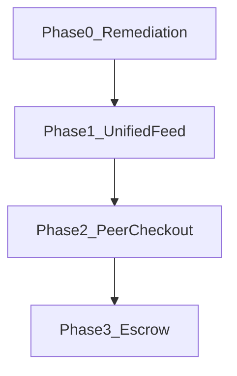

# Phase 3 — Go / No-Go checklist

**Purpose:** Decide whether the team may **start Phase 3 implementation** (Delivery & escrow).  
**Program:** [`TEAM_ROADMAP.md`](./TEAM_ROADMAP.md) · **Live status:** [`PHASE0_STATUS.md`](./PHASE0_STATUS.md)  
**Formal gate in:** Phase 2 peer checkout works end-to-end.

Use this doc at program sign-off (John) before opening `feature/escrow`.

---

## How to read this

| Verdict | Meaning |
|---------|---------|
| **GO** | All **Hard blockers** pass; Phase 1–2 exit criteria met; safe to start Phase 3 coding |
| **NO-GO** | Any **Hard blocker** fails — finish prerequisite phase first |
| **Conditional GO** | Hard blockers pass; some **Deferrable** items open — document debt in sign-off notes and assign owners |

**Rule:** Inbox polish, cart UX polish, and stylist edge cases do **not** block Phase 3. Broken **payment → order creation** does.

---

## Decision summary (fill at sign-off)

| Field | Value |
|-------|-------|
| **Date** | |
| **Branch / commit** | |
| **Signed by** | John (program owner) |
| **Verdict** | GO / NO-GO / Conditional GO |
| **Notes** | |

---

## Gate cascade

Phase 3 builds on checkout and orders. Do not skip layers.



| Layer | Roadmap phase | Entry to next |
|-------|---------------|---------------|
| Remediation | Phase 0 | All P0 Done or Verify-pass on `zeus` |
| Discovery | Phase 1 | Peer listings on Home/Discover; pagination |
| Checkout | Phase 2 | Buy listing end-to-end; listing → Sold on payment |
| Escrow | Phase 3 | **This checklist — all Hard blockers GO** |

---

## A. Hard blockers (NO-GO if any fail)

These must pass before Phase 3 implementation starts.

### A1. Program gates

| # | Check | Source | Pass |
|---|-------|--------|------|
| A1-1 | Phase 0 signed off (`All P0 closed` in [`PHASE0_STATUS.md`](./PHASE0_STATUS.md)) | Program | [ ] |
| A1-2 | Phase 1 signed off (peer **Active** listings visible on Home/Discover/search) | [`TEAM_ROADMAP.md`](./TEAM_ROADMAP.md) § Phase 1 | [ ] |
| A1-3 | Phase 2 signed off (peer purchase end-to-end; listing auto-**Sold** on payment) | [`MARKETPLACE_EPIC.md`](./MARKETPLACE_EPIC.md) · MP-10–14 | [ ] |

### A2. Platform & wiring

| # | Check | Source | Pass |
|---|-------|--------|------|
| A2-1 | `npm run lint:mobile` passes on `zeus` | All members | [ ] |
| A2-2 | `repositories/index.ts` — each key assigned once; `createApi*` for shipped domains | [`02_member_catalog_checklist.md`](../qa/02_member_catalog_checklist.md) §1 | [ ] |
| A2-3 | No duplicate route mounts in `backend/router/v1/index.ts` | Platform | [ ] |
| A2-4 | Mobile bundles without duplicate-declaration / missing-factory runtime errors | Platform smoke | [ ] |
| A2-5 | `npm run typecheck:contracts` passes | [`04_commerce_inbox_checklist.md`](../qa/04_commerce_inbox_checklist.md) §1 | [ ] |

### A3. Auth & session (M1 — regression)

| # | Check | ID | Pass |
|---|-------|-----|------|
| A3-1 | Logout lands on Sign In screen | M1-02 | [ ] |
| A3-2 | Session survives app restart (refresh token) | M1 acceptance | [ ] |
| A3-3 | Logout clears cart for next user; prior user cart restores on re-login | M1-08 / PLT-01 | [ ] |

### A4. Catalog checkout path (M2 + M4 — catalog products)

Minimum viable path for **business catalog** orders before escrow.

| # | Check | ID / doc | Pass |
|---|-------|----------|------|
| A4-1 | Discover loads live products; tap opens ProductDetail | M2 manual | [ ] |
| A4-2 | Add to cart persists via `GET /v1/api/cart` | M4-01 | [ ] |
| A4-3 | Checkout completes without `ApiError: 201` console error | M4-03 | [ ] |
| A4-4 | **M-Pesa:** STK prompt on device; app shows “Check your phone…” | M4-13 | [ ] |
| A4-5 | **M-Pesa:** App polls `GET /v1/api/payments/mpesa/requests/:id` | M4-13 | [ ] |
| A4-6 | Order **not** created until payment status is success | M4-13 | [ ] |
| A4-7 | Successful checkout creates order in DB and clears cart | M4 checklist §2.2 | [ ] |

### A5. Peer listing checkout path (Phase 2 — required for Phase 3 scope)

Phase 3 escrow applies to **paid orders**; peer marketplace is in scope.

| # | Check | ID | Pass |
|---|-------|-----|------|
| A5-1 | Active peer listing appears on unified Home/Discover feed | MP-03 / Phase 1 | [ ] |
| A5-2 | Add peer listing to cart (mixed or listing-only line) | MP-10 | [ ] |
| A5-3 | Pay for listing order; listing status → **Sold** | MP-11 / MP-12 | [ ] |
| A5-4 | Seller notification v1 fires on successful peer payment | MP-11 | [ ] |

### A6. Orders baseline (needed for escrow states)

| # | Check | ID | Pass |
|---|-------|-----|------|
| A6-1 | Purchase History shows completed orders | M4 checklist §2.3 | [ ] |
| A6-2 | Order detail loads status from API (stepper: Placed → Confirmed → Shipped → Delivered) | M4-09 | [ ] |
| A6-3 | Order totals match backend (subtotal + VAT + shipping) | M4 checklist §2.3 | [ ] |

---

## B. Deferrable (do not block Phase 3)

Track these as **known debt**; assign to Phase 4 or parallel polish sprints.

| # | Item | ID | Owner | Target phase |
|---|------|-----|-------|--------------|
| B1 | Wishlist shows “Loading…” / 0 KES (hydration) | M2-03 | Brian | Phase 1 / 4 |
| B2 | Duplicate React key on ProductDetail Similar items | M2-05 | Brian | Phase 1 |
| B3 | Remove duplicate Buy Now button | M2-07 | Brian | Phase 1 |
| B4 | Minus disabled/grey at cart qty 1 | M4-12 | Shannon | Phase 4 |
| B5 | Optimistic cart +/- hardened | M4-11 | Shannon | Phase 4 |
| B6 | Inbox avatar, relative time, unread badges | M4-06 | Shannon | Phase 4 |
| B7 | Read receipt on open conversation | M4 checklist §2.4 | Shannon | Phase 4 |
| B8 | Stylist empty-wardrobe / timeout fallbacks | M4 checklist §2.5 | Shannon | Phase 5 |
| B9 | BrandDetail / StyleDetail API feeds | M2-06 | Brian | Phase 1 P2 |
| B10 | Card checkout full pass | M4-10 | Shannon | Phase 2+ |
| B11 | M1 OTP / password reset / seller profile polish | M1-03–05 | John | Phase 0 P1 |
| B12 | `npm test` / PLT-04 CI green | PLT-04 | John | Phase 0 P1 |

**Conditional GO rule:** If all **Section A** items pass and only **Section B** items fail, record them in the sign-off notes and proceed.

---

## C. Phase 3 readiness (start implementation)

Complete before opening `feature/escrow` (can be done in parallel with late Phase 2 fixes if Hard blockers are green).

**Team context:** Read [`PHASE3_WORK_SPLIT.md`](./PHASE3_WORK_SPLIT.md) for payment procedure, delivery/escrow happy path, buyer–seller interaction, and the **money-core work (C-CORE-*)** before coding escrow UI.

**Scope change (2026-07-22):** Recommendations v1 is deferred; the money core is **split evenly across all four members**. C1–C4 are now authored + implemented (not sign-off only). Payout, refunds, notifications infra, idempotency, and reconciliation are now Phase 3 deliverables (C7–C15).

### Design / spec deliverables

| # | Deliverable | Owner | Pass |
|---|-------------|-------|------|
| C1 | Escrow policy ADR (hold duration, **auto-release window**, **refund window**, dispute route) — **accepted**: [`ESCROW_POLICY.md`](../architecture/ESCROW_POLICY.md) | John | [x] |
| C2 | Order state machine spec (paid → in_escrow → shipped → delivered → released; + cancelled/refunded/disputed), single-writer + per-actor authorization — **shipped**: [`orderStateMachine.ts`](../../backend/services/orderStateMachine.ts) | Shannon | [x] |
| C3 | Payment webhook handling design (Paystack / M-Pesa → order status), single source of truth — **shipped**: [`paymentWebhookService.ts`](../../backend/services/paymentWebhookService.ts) | Shannon | [x] |
| C4 | Contract updates for escrow fields on `OrderDto` + `payments` table — **shipped**: [`PHASE3_C_CORE_1_HANDOFF.md`](./PHASE3_C_CORE_1_HANDOFF.md) | John | [x] |
| C5 | Buyer “Confirm receipt” UI spec | Shannon (M4) | [ ] |
| C6 | Seller shipping handoff copy | Felix (M3) | [ ] |

### Money-core deliverables (new — pulled into Phase 3, split across the team)

| # | Deliverable | Owner | Ref | Pass |
|---|-------------|-------|-----|------|
| C7 | Order-status migration + `payments` table + transition timestamps — **shipped**: [`012_escrow_orders.sql`](../../database/migrations/012_escrow_orders.sql), handoff: [`PHASE3_C_CORE_1_HANDOFF.md`](./PHASE3_C_CORE_1_HANDOFF.md) | John | C-CORE-1 | [x] |
| C8 | **DB-backed** idempotency replacing in-memory [`idempotencyStore`](../../backend/payments/idempotencyStore.ts) — **shipped** | Shannon | C-CORE-3 | [x] |
| C9 | Payout / settlement (Paystack subaccounts or Transfers) + seller payout-details form — **verified on code path**: `released` commits; `payoutOnRelease` is fire-and-forget; Transfers stay off until the business is registered (`PAYSTACK_TRANSFERS_ENABLED`). Evidence: [`orderTransitionEffects.test.ts`](../../backend/services/orderTransitionEffects.test.ts), `npm run verify:escrow-pass` (released in <20s) | Felix | C-CORE-4 | [x] |
| C10 | Refund path (`refunded` state + manual ops runbook + buyer "report a problem" → `disputed`) — **verified**: ship-by miss → `cancelled` (+ `refunded` when Paystack accepts); buyer dispute → `disputed`; ops runbook [`DISPUTED_ORDERS_RUNBOOK.md`](./DISPUTED_ORDERS_RUNBOOK.md). Evidence: `verify:escrow-pass`, [`paystack.test.ts`](../../backend/handlers/webhooks/paystack.test.ts) | Felix + Shannon | C-CORE-5 | [x] |
| C11 | Reconciliation / Verify-Transaction job for stuck / raced / paid-no-order cases — **verified**: C-CORE-6a detect/fix/flag + 6b `statusRepairPort`; `GET /v1/api/internal/stuck-orders` includes `disputed`. Evidence: [`internal.test.ts`](../../backend/router/v1/internal.test.ts), `verify:escrow-pass` stuck-orders | John | C-CORE-6 | [x] |
| C12 | Timers: auto-release on no-confirm; ship-by → auto-cancel + refund — **verified**: [`timersService.test.ts`](../../backend/services/timersService.test.ts), `POST /v1/api/internal/timers/process` in `verify:escrow-pass` | Brian | C-CORE-7 | [x] |
| C13 | Real notifications table + webhook writes + Expo push send (token capture on device) — **verified on backend**: D10 reminder inserts (buyer days 3/6, seller day 2, never `disputed`); `POST /tokens` exists. Device push is a no-op until an EAS `projectId` exists (carried forward, not a Phase 3 blocker). Evidence: [`timersService.test.ts`](../../backend/services/timersService.test.ts) | Brian + Shannon | C-NOTIF-1/2 | [x] |
| C14 | Multi-seller decision: **v1 single-seller checkout** (ADR D9) — shipped; cart may mix sellers, orders may not (`MULTI_SELLER_NOT_ALLOWED`) | John | C-CORE-8 | [x] |
| C15 | Seller KYC / settlement / escrow terms conversation opened with Paystack (external lead time) — **done**: KYC complete, account live on 2026-07-28 | John (+ program/legal) | C-CORE-9 | [x] |

**Sequencing:** C7 (schema) lands week 1 so C2/C3 can build on it. Open C9/C15 (Paystack subaccounts/KYC) on day 1 in parallel.

**Status (2026-09-23, Phase 3 close-out):** C1–C4, C7–C15 are closed for Phase 3. C5/C6 remain UI-copy tickets and do not block sign-off. Live Paystack Transfers and EAS `projectId` push are carried forward — see [`PHASE3_NEXT.md`](./PHASE3_NEXT.md). Verification: [`PHASE3_INTEGRATION_STATUS.md`](./PHASE3_INTEGRATION_STATUS.md) §8.

---

## D. Mapped from member QA checklists

Quick cross-reference for manual QA sessions.

### [`04_commerce_inbox_checklist.md`](../qa/04_commerce_inbox_checklist.md)

| Checklist section | Hard blocker? | Section |
|-------------------|---------------|---------|
| §1 Automated (contracts, vitest, verify:gate) | Partial — A2-5; vitest recommended | A |
| §2.1 Cart CRUD | Tenant isolation yes; minus-at-1 no | A4 / B4 |
| §2.2 Payment & checkout | **Yes** — STK, poll, order timing | **A4** |
| §2.3 Orders & tracking | Baseline yes; grouping polish deferrable | A6 |
| §2.4 Inbox & messaging | Send message yes; read receipt / badges no | B6–B7 |
| §2.5 Stylist AI | Live API yes; fallbacks no | B8 |

### [`02_member_catalog_checklist.md`](../qa/02_member_catalog_checklist.md)

| Checklist section | Hard blocker? | Section |
|-------------------|---------------|---------|
| §1 Post-merge wiring | **Yes** | A2 |
| §2 API products/wishlist | Wishlist API yes; display hydration no | A / B1 |
| §3.1–3.3 Discover / detail | Feed + ProductDetail yes | A4 |
| §3.4 Wishlist sync | Persist yes; display / duplicate keys no | B1–B2 |
| §3.5 Brand/style detail | No | B9 |

### M3 wardrobe / sell ([`03_MEMBER_WARDROBE_SELL.md`](./03_MEMBER_WARDROBE_SELL.md))

| Check | Hard blocker? | Section |
|-------|---------------|---------|
| Wardrobe CRUD + list for sale | Yes (Phase 2 supply) | A5 |
| Draft → Active, sold persists | Yes for peer lifecycle | A5 |
| List-for-sale spinner / polish | No | Phase 1–2 P1 |

---

## E. Automated pre-flight (run before sign-off meeting)

```bash
# Repo root
npm install
npm run lint:mobile
npm run typecheck:contracts
npm run verify:deps
npm test                    # PLT-04

# Optional — API running
npm run dev:api
npm run verify:gate
```

Mobile: `EXPO_PUBLIC_USE_MOCK_DATA=false`, seed `dev+buyer@luku.app` / `LukuDev2026!`

Manual smoke (minimum):

1. Catalog: Discover → ProductDetail → Add to cart → checkout (M-Pesa real `254…` number).
2. Peer: Discover listing → Add to cart → pay → listing **Sold**.
3. Orders: Purchase History → order detail stepper reflects DB status.

---

## F. Sign-off log

| Event | Date | Verdict | Signed by | Open debt (Section B IDs) |
|-------|------|---------|-----------|---------------------------|
| Phase 3 go/no-go review | | | | |

---

## Related docs

- [`PHASE3_WORK_SPLIT.md`](./PHASE3_WORK_SPLIT.md) — roles, payment/delivery procedure, buyer–seller flow
- [`PHASE3_TICKETS.md`](./PHASE3_TICKETS.md) — per-owner tickets mapped to C7–C15
- [`PHASE3_C_CORE_1_HANDOFF.md`](./PHASE3_C_CORE_1_HANDOFF.md) — shipped schema, enum values, and config module (read before escrow work)
- [`../architecture/ESCROW_POLICY.md`](../architecture/ESCROW_POLICY.md) — escrow ADR (C1 draft)
- [`TEAM_ROADMAP.md`](./TEAM_ROADMAP.md) — Phase 3 scope
- [`MARKETPLACE_EPIC.md`](./MARKETPLACE_EPIC.md) — Phase 1–2 marketplace tasks (MP-*)

- [`PHASE0_STATUS.md`](./PHASE0_STATUS.md) — live remediation dashboard
- [`docs/payments/integration-checklist.md`](../payments/integration-checklist.md) — M-Pesa / Paystack secrets and flows

---

## Changelog

| Date | Change |
|------|--------|
| 2026-07-15 | Initial go/no-go checklist for Phase 3 entry |
| 2026-07-22 | Scope change: recommendations deferred; money core split evenly across all four members. C1–C4 now authored + implemented; added money-core gates C7–C15 (migration, idempotency, payout, refunds, reconciliation, timers, notifications, multi-seller, KYC). |
| 2026-07-28 | C15 closed (Paystack KYC complete, live keys active). C4 + C7 closed: migration `012_escrow_orders.sql` shipped with escrow statuses, transition timestamps, `payments`, `processed_webhook_events`, peer-listing orders, and the `escrowPolicy` config module. Handoff: [`PHASE3_C_CORE_1_HANDOFF.md`](./PHASE3_C_CORE_1_HANDOFF.md). |
| 2026-07-29 | C14 closed: D9 single-seller **block** (not split). C11 partial: C-CORE-6a reconciliation detect/fix/flag; 6b waits on Shannon StatusRepairPort. |
| 2026-08-07 | C-CORE-8 refined: the cart may hold several sellers and the buyer checks out one seller per order; the order guard stays the hard lock and only purchased lines leave the cart. |
| 2026-08-12 | Shannon merged into `feature/phase3-order-schema`: C2 and C3 closed (order state machine as single writer, `charge.success` handling), C8 closed (DB-backed idempotency). C9/C10/C13 marked partial — Felix's and Brian's code is on `zeus`, unwired. Checkout safety rails added after an RLS incident charged buyers without creating orders. Payout migration renumbered `013` → `015` to clear Brian's notification migrations. New runbook: [`PHASE3_INTEGRATION_STATUS.md`](./PHASE3_INTEGRATION_STATUS.md). |
| 2026-08-12 | `zeus` merged forward — all four tracks now compile and test in one tree for the first time. **D12 accepted:** escrow holds the full captured charge (`subtotal + VAT`), payout base stays the line-item subtotal; `payments.amount_minor` corrected to the full capture, which makes reconciliation amount mismatches meaningful and refunds D11-compliant. Closes the open tax question. **Security:** the Paystack charge and M-Pesa STK endpoints were unauthenticated and now require `verifyToken`; server-priced checkout raised as the follow-up ticket. `resolveSellerUserId` shipped, unblocking business-seller payouts. **Blocking finding:** nothing advances an order past `paid`, which silently disables payout, refunds and Brian's timers — see [`PHASE3_INTEGRATION_STATUS.md`](./PHASE3_INTEGRATION_STATUS.md) §4.0 and the transition wiring guide in the handoff doc. |
| 2026-09-23 | Phase 3 close-out: C9–C13 ticked with evidence (`npm test`, `verify:escrow-pass`, `verify:order-api`). Live Transfers and EAS `projectId` carried forward. |
