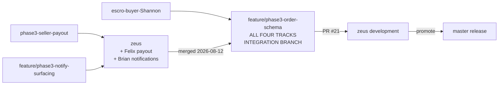
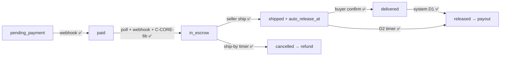

# Phase 3 — integration status and next steps

**Updated:** 2026-09-02 · **Owner:** John (platform lead)
**Development:** `zeus` (cut a new branch, PR into `zeus`) · **Release:** `master`
(John promotes `zeus` → `master`) · **Frozen:** `legacy-master`

Four people built the escrow money core in parallel. **All four tracks are now
in one tree** on `zeus`. This is the detailed runbook — what still has to happen
before any of it moves real money, and who is blocked on whom.

**Prefer the friendly version first?** Start at
[`PHASE3_TEAM_UPDATE.md`](./PHASE3_TEAM_UPDATE.md) — plain-English explanation of the
same story, then come back here for depth.

Read [`PHASE3_C_CORE_1_HANDOFF.md`](./PHASE3_C_CORE_1_HANDOFF.md) first if you
are touching orders, payments, or escrow state — in particular
[Driving a transition](./PHASE3_C_CORE_1_HANDOFF.md#driving-a-transition--for-shannon-felix-and-brian),
which is the wiring guide for escrow transitions. This doc assumes it.

> **Headline:** poll checkout and the Paystack webhook both reach `in_escrow`.
> Confirm receipt releases and pays out (line-item subtotal). A ship-by miss
> cancels then refunds. D2 auto-releases `shipped` past `auto_release_at`.
> C-CORE-6b is injected. Seller GET + Mark as shipped is in the app. Remaining
> gaps are ops (Paystack webhook URL, Transfers) and follow-up tickets (push
> tokens, real shipping address, D10, C-CORE-10, server-priced checkout). See
> §4.0 / §8.

---

## 1. Where the code actually is

Branch names on the remote drift from [`PHASE3_KICKOFF.md`](./PHASE3_KICKOFF.md).
Use the real ones:

| Owner | Track | Branch in the kickoff doc | **Real branch** | Merged into |
|-------|-------|---------------------------|-----------------|-------------|
| John | Data foundation + reconciliation | `feature/phase3-order-schema` | `feature/phase3-order-schema` | — (this is the integration branch) |
| Shannon | Payment truth + buyer escrow | `feature/phase3-escrow-buyer` | **`escro-buyer-Shannon`** | `feature/phase3-order-schema` (PR #19) |
| Felix | Seller + money movement | `feature/phase3-seller-payout` | **`phase3-seller-payout`** (no `feature/`) | `zeus` (PR #18) → integration branch |
| Brian | Notifications, timers, surfacing | `feature/phase3-notify-surfacing` | `feature/phase3-notify-surfacing` | `zeus` (PR #17) → integration branch |

Nobody should rename a branch to match the kickoff doc — it breaks local refs
and open PRs. The kickoff doc has been corrected to these names instead.

### Where to cut remaining work

Two lines: **`zeus`** is development (cut a new branch, PR into `zeus`).
**`master`** is release (John promotes `zeus` → `master`). **`legacy-master`**
is a frozen snapshot of the old web-era `master` — do not commit there.

```bash
git fetch origin
git checkout -b feature/<your-ticket> origin/zeus
```

Do not keep committing on `escro-buyer-Shannon`, `phase3-seller-payout`, or
`feature/phase3-notify-surfacing` — those tips are already merged. Do not pile
Shannon’s webhook chain, Felix’s ship route, or Brian’s timers onto `zeus`
itself (open a PR) or onto `master`.

Migrations run **once on the shared Supabase project**. Nobody runs a local
Postgres. **016 is already applied.** **015** is Felix, once, on that project.

The shareable version of this rule is
[How to continue](./PHASE3_TEAM_UPDATE.md#how-to-continue).



`zeus` has been merged forward. The payout half and the escrow-state half now
compile, typecheck and test together for the first time. Both `server.ts`
conflicts were additive and both sides were kept.

**One thing the merge broke and how it was fixed:** Brian's
`notificationsService` now reads the persisted `notifications` table the
order-status trigger writes, rather than deriving copy from order status at
read time. The existing tests asserted the old derived behaviour and were
rewritten to cover the table read instead. If you were relying on
`getNotifications` synthesizing an order notification, it no longer does — the
trigger writes the row.

---

## 2. What has landed on the integration branch

| Ticket | What shipped | Owner |
|--------|--------------|-------|
| C-CORE-1 | `012_escrow_orders.sql`, `payments`, `processed_webhook_events`, escrow statuses, `escrowPolicy` | John |
| C-CORE-2 | [`orderStateMachine.ts`](../../backend/services/orderStateMachine.ts) — single writer, per-actor authorization, compare-and-swap | Shannon |
| C-CORE-3 | [`paymentWebhookService.ts`](../../backend/services/paymentWebhookService.ts) + DB-backed [`idempotencyStore`](../../backend/payments/idempotencyStore.ts) | Shannon |
| C-CORE-6a | [`paystackVerify.ts`](../../backend/payments/paystackVerify.ts), [`reconciliationService.ts`](../../backend/payments/reconciliationService.ts), `POST /v1/internal/reconcile` | John |
| C-CORE-8 | [`sellerKey.ts`](../../backend/services/sellerKey.ts) + the `createOrder` guard; multi-seller cart, single-seller order | John |
| C-CORE-4 | [`payout.ts`](../../backend/payments/payout.ts), [`payoutDetailsService.ts`](../../backend/services/payoutDetailsService.ts), recipient handlers + routes, `PayoutDetailsScreen` | Felix |
| C-CORE-5 | [`refund.ts`](../../backend/payments/refund.ts) — 100% reversal per D11 | Felix |
| C-NOTIF-1/2 | `013_notifications.sql`, `014_push_tokens.sql`, order-status trigger → `POST /webhooks/orders` → Expo push, `POST /tokens` | Brian |
| D12 | Escrowed amount vs payout base; `amount_minor` is now the full capture; shared `VAT_RATE` | John |
| — | Charge and STK endpoints now require `verifyToken` (§3.3) | John |
| — | [`sellerIdentity.ts`](../../backend/services/sellerIdentity.ts) — `resolveSellerUserId`, unblocks business-seller payouts (§3.2) | John |
| — | Checkout safety rails after the RLS incident (§6); `016_ensure_payment_record.sql` DEFINER RPC | John |
| — | Buyer shipping address capture with validation, replacing the hardcoded placeholder | Shannon |
| — | Per-seller cart grouping and checkout, themed confirm dialog, safe retry | John |

Verified green after the `zeus` merge: `npm test`, `typecheck:backend`,
`typecheck:contracts`, mobile `tsc --noEmit`, `lint:mobile`.

---

## 3. Things that will bite

### 3.1 Migration numbers collide

Brian's work is on `zeus` and already claimed `013_notifications.sql` and
`014_push_tokens.sql`. The seller payout migration has been renumbered to
[`015_seller_payout_details.sql`](../../database/migrations/015_seller_payout_details.sql)
to match. Nobody should have to discover this by applying migrations out of
order against shared dev.

**Rule going forward:** claim your migration number in
[`database/migrations/README.md`](../../database/migrations/README.md) on `zeus`
*before* you write the file, not when you open the PR.

### 3.2 `015` does not match Felix's code as written

The original sketch guessed every column name and got every one of them wrong.
It has been rewritten against what
[`payoutDetailsService.ts`](https://github.com/johnombuya/luku/blob/phase3-seller-payout/backend/services/payoutDetailsService.ts)
actually reads and upserts: `seller_id`, `type`, `label`, `account_name`,
`recipient_code`. The sketch's `account_number` and `bank_code` NOT NULL columns
were dropped — his handler never writes them, so every insert would have failed.

**The `seller_id` ambiguity — resolved, one call site left for Felix.**
`orders` carries two mutually exclusive seller columns: `seller_id` (a
`business_accounts.id`) and `seller_user_id` (an `auth.users.id`).
`seller_payout_details.seller_id` references `auth.users`, because that is the
only id an RLS policy can compare against `auth.uid()` — and Felix's write path
is already consistent with that, storing against `req.userId` in
`createRecipientHandler`.

Only the **read** path needs the mapping. [`resolveSellerUserId`](../../backend/services/sellerIdentity.ts)
now does it and is tested. `payout.ts` is untouched — that is Felix's file:

```ts
import { resolveSellerUserId } from '../services/sellerIdentity';

const sellerUserId = await resolveSellerUserId(order);   // not order.seller_id
const details = await getPayoutDetails(sellerUserId);
```

Without this, peer-listing payouts work and every business-seller payout fails
with "no payout details on file" even though the seller registered them. The
peer path working is what makes it easy to misread as a data problem.

### 3.3 Two payment endpoints were unauthenticated

`POST /v1/api/payments/paystack/charges` and `/mpesa/stk-push` were mounted with
no `verifyToken`, directly above `/paystack/recipients` which had it. They take
a **client-supplied amount**, so anyone could initiate a charge against the
platform's Paystack account. Both, their status-poll sibling, and the
deprecated legacy twins now require a token. The mobile client already sends
one on every request, so nothing changed for the app.

The archived `web-legacy` client calls the legacy paths without a token and
will now get 401. It is reference material with no run script; leaving those
paths open would have left the hole fully usable.

**This is a mitigation, not the fix.** The server still trusts the amount the
client asks to be charged — see the ticket in §7.

---

## 4. Per-person next steps

### 4.0 Money path (poll + webhook)

Shannon / Felix / Brian **functions and routes** were already in the tree; this
slice connects status changes to Paystack Transfers/refunds and gets poll
checkout out of `paid`.



What is hooked:

- **Poll path:** `createOrder` best-effort `paid → in_escrow` (illegal
  transition / not-found is a no-op so a webhook that already ran does not
  fail checkout).
- **Webhook path:** `charge.success` still chains `paid → in_escrow`.
- **C-CORE-6b:** `runReconciliation` injects `statusRepairPort`.
- **Ship:** stamps `auto_release_at = now + autoReleaseDays` on the same CAS
  as `shipped`.
- **Confirm receipt (D1):** `shipped → delivered` then immediately
  `delivered → released`; `payoutOnRelease` uses the **line-item `total_price`
  sum**, not `payments.amount_minor`. Transfer failures are logged; status is
  not rolled back.
- **Ship-by miss:** `in_escrow → cancelled` then `refundOrder` then
  `refunded`. Paystack failures leave the order `cancelled`.
- **D2:** timers select `status = shipped` and `auto_release_at < now`, then
  `shipped → released`. `disputed` is a pause (not selected).
- **Seller UI:** GET orders as buyer **or** seller; Order Tracking **Mark as
  shipped**; `POST /:id/ship` 409 is `CONFLICT`.

Shannon / Felix / Brian ticket bodies in [`PHASE3_TICKETS.md`](./PHASE3_TICKETS.md)
are unchanged. Follow-ups that are **not** this wiring: Paystack webhook URL +
Transfers (ops), Expo push tokens, real shipping address, D10 reminders,
C-CORE-10, server-priced checkout.

Paste-ready shapes remain in
[Driving a transition](./PHASE3_C_CORE_1_HANDOFF.md#driving-a-transition--for-shannon-felix-and-brian).

### Shannon — payment truth, buyer escrow

The §4.0 wiring (webhook + poll `in_escrow`, confirm-receipt/dispute routes +
buyer UI, `StatusRepairPort`) has landed. Remaining Shannon **feature** tickets
are unchanged in [`PHASE3_TICKETS.md`](./PHASE3_TICKETS.md) (push tokens,
shipping address). Historical notes below are the original remaining list.

The state machine and the webhook are in. Remaining, highest leverage first:

1. **Chain `paid -> in_escrow` in the webhook** — two lines, unblocks Brian
   entirely. See §4.0.
2. **`POST /:id/confirm-receipt` and `POST /:id/dispute`** on top of
   `confirmOrderDelivery` and `reportOrderProblem`, plus the buyer UI.
3. **Export a `StatusRepairPort`** so C-CORE-6b can unblock. A paste-ready
   adapter over `transitionOrder` is in the handoff doc; the shape
   reconciliation expects is `markPaidFromProvider({ reference, amountMinor,
   currency, paidAt, raw })` returning `{ ok: true } | { ok: false, reason }`.
   Treat `IllegalOrderTransitionError` as success so the job stays retryable.

Worth knowing: **`createOrder` is now idempotent per payment reference.** It
returns the existing order rather than creating a second one, so retries,
webhook ordering and the M-Pesa poll can all safely re-enter with the same
reference.

### Felix — payout and refunds

`payoutOnRelease` / `refundOrder` are now invoked from transition side-effects
(see §4.0). Remaining Felix **feature** tickets are unchanged in
[`PHASE3_TICKETS.md`](./PHASE3_TICKETS.md). Historical notes below are the
original remaining list.

Two corrections to your PR notes first, both in your favour:

- **Recipient routes are registered.** They are mounted with `verifyToken` in
  `server.ts` alongside the other payment routes. `PayoutDetailsScreen` has an
  endpoint to call. Your PR said otherwise; it was stale.
- **`payments.amount_minor` is now the full captured amount** (D12), so the
  note in `refund.ts:33-35` is stale too and the workaround can come out. A
  100% reversal of `amount_minor` is now D11-correct on its own.

Remaining, in order:

1. **`015` applied.** The `seller_id` question is answered (§3.2) — it is an
   `auth.users` id and your write path already matches. Just apply it.
2. **One line in `payoutOnRelease`:** resolve the seller through
   `resolveSellerUserId(order)` rather than passing `orders.seller_id`. The
   helper and its tests are shipped; the call site is yours.
3. **`POST /v1/api/orders/:id/ship`** calling `markOrderShipped()` — never a
   direct `orders.update()`. Shape in the handoff doc. This is one of the three
   pieces in §4.0.
4. **Hand `calculatePayout` the line-item subtotal**, from
   `order_items.total_price`. Not `amount_minor`, which now includes VAT (D12).

Still outstanding: `transfer.success` / `transfer.failed` and
`refund.processed` / `refund.failed` webhooks — the current code only reads
Paystack's initial synchronous response, so a transfer that fails
asynchronously is invisible today. And tests for `calculatePayout` and the
handlers.

### Brian — notifications, timers

Your work is merged forward and compiles against the state machine.

- **Read §4.0 before debugging your timers.** Poll checkout and the webhook
  both reach `in_escrow`. Auto-cancel is `in_escrow -> cancelled` (then
  refund). If a timer still looks idle, check `ship_by_at` / `auto_release_at`
  are non-null, not whether the order left `paid`.
- **C-CORE-7 timers must go through `transitionOrder`.** Auto-cancel is
  `in_escrow -> cancelled` with actor `system`; auto-release is
  `shipped -> released` (D2: 7 days after shipped), also `system`. Dispute
  pauses the job because it only selects `shipped` / `in_escrow`. Do not write
  `orders.status` directly — the compare-and-swap in the state machine is what
  makes a timer racing a buyer action safe.
- **Your notification tests were rewritten** in the merge, because the service
  moved from deriving order copy at read time to reading the table your trigger
  writes. Worth a look to confirm the new tests match what you intended.
- A stray file named `c` (captured `git log` output) was committed to `zeus`.
  Deleted here; it will disappear from `zeus` when this branch merges back.

### John — reconciliation, platform

- **C-CORE-6b is wired:** `statusRepairPort` is passed into
  `runReconciliation`. Orphan captures with no order stay flag-only.
- **Run the stranded-charge triage** in §6 against production.
- **Server-priced checkout** (§7) — the real fix behind the §3.3 mitigation.
- Promote `zeus` → `master` when a slice is ready. Remaining work PRs into
  `zeus`; do not PR into `master`.
- Done since last update: integration PR #21 on `zeus`, first promote onto
  `master`, D12 decided and implemented, charge endpoints authenticated,
  `resolveSellerUserId` shipped, checkout unblocked via `ensure_payment_record`
  (016).

---

## 5. Invariants to protect on any future merge

`zeus` has been merged forward (2026-08-12). Both `server.ts` conflicts were
additive — `zeus` adds notification and order-webhook routes, this branch adds
the `assertServiceRoleKey` boot guard and the internal reconcile router — and
both sides were kept.

These are the properties a future merge is most likely to quietly undo. Check
them after any non-trivial conflict resolution:

- `assertServiceRoleKey(process.env)` must survive in `server.ts`.
- `transitionOrder` stays the only writer of `orders.status`.
- The `createOrder` order of operations: single-seller guard → idempotency
  lookup → `ensurePaymentRecord` → RPC → `removeCartProducts` → best-effort
  `paid → in_escrow`. The idempotency early-return stays ahead of
  `ensurePaymentRecord`. Failure of the escrow promote must not fail checkout.
- Order totals are `subtotal + VAT` with no shipping fee. If a merge restores
  the hardcoded `shipping = 500`, drop it again.
- `payments.amount_minor` is `subtotal + VAT` (D12), never the subtotal alone.
- The charge and STK routes keep their `verifyToken`.

---

## 6. Stranded charges from the RLS incident

Checkout used to INSERT into `payments` as the PostgREST client. RLS on that
table has no INSERT policy, so the write failed **after** Paystack captured
the money, and each retry issued a fresh reference and charged again. The
service role key was not the cause.

Checkout now writes through `ensure_payment_record` (migration **016**,
`SECURITY DEFINER`). Idempotent `createOrder` and client-side reference reuse
remain; details in
[`PHASE3_C_CORE_1_HANDOFF.md`](./PHASE3_C_CORE_1_HANDOFF.md).
Webhook and reconciliation still write `payments` as table DML — known residual,
not this checkout path.

The money that was already taken still needs cleaning up:

```bash
npm run triage:payments -- --days 30
```

It starts from the Paystack transaction list, because this failure leaves no
local `payments` row to query. It is strictly read-only. For each
`payment_row_missing` row, either refund the buyer or create the order manually —
both are deliberate human decisions, not something to automate.

---

## 7. Decided: D12, and the ticket it leaves behind

### 7.1 The tax question is answered

Previously open. **Escrow holds the full captured charge (`subtotal + VAT`);
the payout base is the line-item subtotal.** Recorded as
[D12](../architecture/ESCROW_POLICY.md#d12-in-practice).

This was not a new decision so much as noticing the code contradicted policy we
already had. D7 takes commission on **item price**, and D11 requires returning
**100% of what the buyer paid** — those two together already determined the
answer. `createOrder` now writes the full capture to `amount_minor`.

Two consequences worth internalising:

- **Reconciliation amount mismatches now mean something.** They used to fire on
  every single order, so they were noise. A mismatch is now a real signal.
- **Never pass `amount_minor` to `calculatePayout`.** It includes VAT the
  platform remits; the seller would be paid a cut of tax.

### 7.2 Open ticket — server-priced checkout

**Owner: unassigned. Not implemented here** because it touches the shared
payment handlers that Shannon and Felix both build on, and it deserves its own
review rather than riding along with a money-math fix.

**Problem.** The client tells the server what to charge. `CartScreen` computes
`subtotal + VAT` locally and posts it as `amount` to
`POST /v1/api/payments/paystack/charges`. The server passes it to Paystack
unexamined. §3.3 closed anonymous access, so this now requires a logged-in
account — but a logged-in user can still name their own price.

**Fix.** Price the cart server-side. The handler should take a cart or order
reference, read `cart_items` and the product prices, compute
`subtotal + VAT` from `escrowPolicy.vatRate`, and **ignore any client-supplied
amount**.

**Why it is worth doing beyond the security fix:** it collapses the duplicated
VAT calculation. Today the rate is shared via `VAT_RATE` so the two sides
cannot drift numerically, but the *computation* still happens twice. With
server pricing, the client figure becomes purely a display estimate with no
authority at all, which is what it should have been.

**Acceptance:** a charge request with a tampered `amount` is charged the
correct server-computed total; the mobile app's displayed total still matches
for an untampered cart; `payments.amount_minor` continues to equal the capture.

---

## 8. Integration checkpoint

Run on `zeus` (and again after a promote to `master`) before treating a slice
as the release line. All of it must pass on one build, with
`EXPO_PUBLIC_USE_MOCK_DATA=false` and a real `service_role` key. Steps 6–9 are
the escrow money pass. Step 8 (live Transfers) and step 10 (device push) are
carried forward — see [`PHASE3_NEXT.md`](./PHASE3_NEXT.md).

**Automated**

```bash
npm test
npm run typecheck:backend
npm run typecheck:contracts
npm run lint:mobile
npm run triage:payments -- --strict   # must exit clean
npm run verify:escrow-pass            # needs npm run dev:api
npm run verify:order-api
npm run verify:order-api -- --peer
```

### 8.1 Verification run — 2026-09-23 (`feature/phase3-closeout`)

Signed synthetic Paystack webhooks + temporary rows on the shared Supabase
project; fixtures deleted afterwards. No real M-Pesa charge.

| Command | Result |
|---------|--------|
| `npm test` | 67 files / 553 tests passed |
| `npm run typecheck:backend` | clean |
| `npm run typecheck:contracts` | clean |
| `npm run lint:mobile` | clean (after `expo-notifications` / `expo-device` workspace install) |
| `npm run triage:payments -- --strict` | clean — no successful Paystack transactions in the last 7 days |
| `npm run verify:escrow-pass` | passed: `in_escrow` → `released` in 1948ms (Transfers off); `disputed`; ship-by miss → `cancelled`, listing `Active` (MP-12); stuck-orders includes disputed; signed `transfer.success` / `transfer.failed` / `refund.processed` → 200; cleanup leaves no webhook, order, or notification rows |
| `npm run verify:order-api` | passed (catalog → `in_escrow`) |
| `npm run verify:order-api -- --peer` | passed (peer → `in_escrow`, listing Sold, cleaned up) |

**Manual leftovers (device / dashboard — not Phase 3 blockers)**

1. Paystack dashboard "Send test webhook" through `npm run tunnel:api` returns 200 (Live Webhook URL when keys are live).
2. Checkout pre-fills the saved address on the second purchase.
3. A disputed order shows ON HOLD, with separate buyer and seller copy.
4. Confirm receipt works after laptop sleep or a network change without restarting `dev:api`.
5. A reminder notification in the inbox reads cleanly (no bracket marker).
6. Push stays a no-op until an EAS `projectId` exists.

Re-verification sweep (same day) fixed: reminder dedupe markers leaking into
the inbox body; `cancelled`-but-unrefunded orders missing from stuck-orders;
escrow-pass cleanup leaving `processed_webhook_events` / `notifications` rows.

**Manual, end to end** (historical checklist; 6–7 and 9 covered by `verify:escrow-pass`)

1. Add items from two different sellers to the cart; both survive.
2. Check out one seller; the other seller's items stay in the cart.
3. An order mixing sellers is rejected with `MULTI_SELLER_NOT_ALLOWED`.
4. Payment captured → order created → `paid` / `in_escrow`; cart cleared of only those lines.
5. Retry a captured reference; no second charge, no second order.
6. Order reaches `in_escrow`, not just `paid` (poll path and/or webhook).
7. Seller marks shipped in Order Tracking → buyer sees `shipped`; buyer
   confirms receipt → `delivered` → `released` (payout on the same confirm).
8. Payout fires on release to a **business** seller with a registered recipient
   — the peer path passing is not evidence the business path works (§3.2).
   Requires Paystack Transfers enabled (carried forward).
9. A ship-by miss auto-cancels and refunds (listing returns to `Active`).
10. Push notification arrives on the buyer's device on status change
    (**blocked** on EAS `projectId`; token route already exists).
11. Order totals in the app match `payments.amount_minor` after reconciliation,
    and `amount_minor` matches the Paystack capture exactly (D12).
12. A charge request with no bearer token is rejected (§3.3).

Plus the existing QA sections: [`04_commerce_inbox_checklist.md`](../qa/04_commerce_inbox_checklist.md)
§2.2–2.3 and [`PHASE3_GO_NO_GO.md`](./PHASE3_GO_NO_GO.md) §A4–A6.

---

## Related

- [`PHASE3_TEAM_UPDATE.md`](./PHASE3_TEAM_UPDATE.md) — short shareable action list for WhatsApp/Slack
- [`PHASE3_C_CORE_1_HANDOFF.md`](./PHASE3_C_CORE_1_HANDOFF.md) — schema, safety rails, and the [transition wiring guide](./PHASE3_C_CORE_1_HANDOFF.md#driving-a-transition--for-shannon-felix-and-brian)
- [`PHASE3_GO_NO_GO.md`](./PHASE3_GO_NO_GO.md) — C7–C15 status
- [`PHASE3_TICKETS.md`](./PHASE3_TICKETS.md) — per-owner acceptance criteria
- [`../architecture/ESCROW_POLICY.md`](../architecture/ESCROW_POLICY.md) — ADR-11, D9, [D12](../architecture/ESCROW_POLICY.md#d12-in-practice), the state diagram
