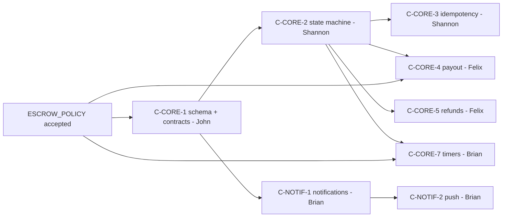

# Phase 3 — ticket breakdown

**Source of scope:** [`PHASE3_WORK_SPLIT.md`](./PHASE3_WORK_SPLIT.md) · **Gates:** [`PHASE3_GO_NO_GO.md`](./PHASE3_GO_NO_GO.md) C7–C15 · **Policy:** [`../architecture/ESCROW_POLICY.md`](../architecture/ESCROW_POLICY.md)

Copy each row into your tracker as an issue. IDs match the work-split (`C-CORE-*`, `C-NOTIF-*`) so go/no-go checkboxes map 1:1. Acceptance criteria are the "done" bar for the go/no-go re-run.

**Legend:** Blocks = must land before dependents start · GNG = go/no-go gate.

---

## John (M1) — data foundation + reconciliation · `feature/phase3-order-schema`

| ID | Title | Depends on | GNG | Acceptance criteria |
|----|-------|------------|-----|---------------------|
| C-CORE-1 | Order-status migration + `payments` table + transition timestamps | ESCROW_POLICY accepted | C7 | Numbered migration adds statuses (`paid`,`in_escrow`,`shipped`,`delivered`,`released`,`cancelled`,`refunded`,`disputed`); `payments` table keyed by Paystack reference; per-transition `*_at` columns; `OrderDto` contract fields added in `packages/contracts` |
| C-CORE-6 | Reconciliation / Verify-Transaction job | C-CORE-1; **6b** also needs C-CORE-2 | C11 | **6a shipped:** Verify + amount fix + pending→failed/abandoned/success + orphan flag; `POST /v1/api/internal/reconcile`. **6b later:** call Shannon `StatusRepairPort.markPaidFromProvider` for order status repair — [paste-ready adapter](./PHASE3_C_CORE_1_HANDOFF.md#statusrepairport--shannon-c-core-6b). Note: amount mismatches were previously firing on every order and are meaningful now that D12 landed |
| C-CORE-8 | Multi-seller decision + enforcement | ESCROW_POLICY D9 | C14 | **Shipped:** cart holds many sellers; `createOrder` blocks mixed sellers (`MULTI_SELLER_NOT_ALLOWED`); cart groups by seller with per-seller checkout; only purchased lines are cleared; unit tests |
| C1/C9 | Escrow ADR authored + KYC conversation opened | — | C1, C15 | [`ESCROW_POLICY.md`](../architecture/ESCROW_POLICY.md) accepted (D1–D10 frozen); Paystack subaccount/transfer + KYC request submitted |

## Shannon (M4) — payment truth + buyer · `feature/phase3-escrow-buyer`

| ID | Title | Depends on | GNG | Acceptance criteria |
|----|-------|------------|-----|---------------------|
| C-CORE-2 | Escrow state machine (single writer) | C-CORE-1 | C2 | All transitions go through one server module; per-actor authorization (seller→`shipped`, buyer→`delivered`/`disputed`); illegal transitions rejected; unit tests per edge |
| C-CORE-3 | DB-backed idempotency | C-CORE-1 | C8 | `charge.success` processed exactly once across restarts; replaces in-memory `idempotencyStore`; duplicate webhook is a no-op; test proves it |
| M4-13 | Poll M-Pesa; create order only after success | — | A4 | Order created strictly after payment success; webhook is single writer of `paid` |
| C5 | Buyer Confirm receipt + escrow stepper | C-CORE-2 | C5 | Order detail shows escrow states; Confirm receipt drives `delivered`→`released`; disabled until `shipped` |
| C-CORE-5(buyer) | Refund / report-a-problem UI | C-CORE-2, Felix C-CORE-5 | C10 | Buyer can report a problem during hold → `disputed`; refund status visible; UI states refund is **100%** of amount paid (D11) |
| C-NOTIF-2(client) | Expo push token registration | Brian C-NOTIF-2 | C13 | Device token captured + stored server-side on login/permission grant |
| — | Real shipping-address / contact capture | C-CORE-1 | — | Replaces hardcoded value in `CartScreen`; address persisted on order; seller can read it |

## Felix (M3) — seller + money movement · `feature/phase3-seller-payout`

| ID | Title | Depends on | GNG | Acceptance criteria |
|----|-------|------------|-----|---------------------|
| C-CORE-4 | Payout via Paystack Transfers + payout-details form | C-CORE-1, ESCROW_POLICY D6, KYC | C9 | On `released`, transfer to seller recipient minus commission (D7); seller settlement details (bank/M-Pesa) captured + validated; test covers payout math |
| C-CORE-5(seller) | Refund path + `disputed` handling | C-CORE-2 | C10 | `refunded` transition reverses charge at **100%** of buyer payment (D11 — no commission taken pre-release); manual ops runbook documented; `disputed` pauses timers; listing may relist |
| — | Mark as shipped + handoff copy | C-CORE-2 | C6 | Seller-authorized `shipped` transition; shipping handoff copy shown; order↔listing linked |
| MP-12 | Sold listing lifecycle | C-CORE-2 | A5 | Paid order hides listing from feed/wardrobe; no "sold but still listed" |

## Brian (M2) — notifications, timers + surfacing · `feature/phase3-notify-surfacing`

| ID | Title | Depends on | GNG | Acceptance criteria |
|----|-------|------------|-----|---------------------|
| C-NOTIF-1 | Notifications table + webhook writes | C-CORE-1 | C13 | Real `notifications` table; rows written on `paid`/`shipped`/`delivered`; replaces synthesized notifications in `notificationsService` |
| C-NOTIF-2 | Expo push send service | C-NOTIF-1 | C13 | Server sends push on key events to registered tokens; retries/logging; test with a stubbed sender |
| C-CORE-7 | Auto-release / ship-by / cancel timers + countdown UI | C-CORE-2, ESCROW_POLICY D2/D3/D10 | C12 | Jobs fire auto-release (D2), auto-cancel+refund (D3), reminders (D10); countdowns visible on order cards |
| C-CORE-10 | Observability + stuck-order dashboard | C-CORE-1 | C10(gng A) | Metrics for paid-not-shipped / shipped-not-confirmed; webhook signature tests; ops view lists stuck orders |
| — | Order surfacing on Home/Discover | C-CORE-1 | — | Escrow/delivery fields + purchase entry surfaced; M2-03/M2-05 cleanup; MP-13 single add-to-cart |

---

## Critical ordering

Only **C-CORE-1** and the **accepted ESCROW_POLICY** are hard prerequisites. Everything else parallelizes across the four owners once the schema lands.
