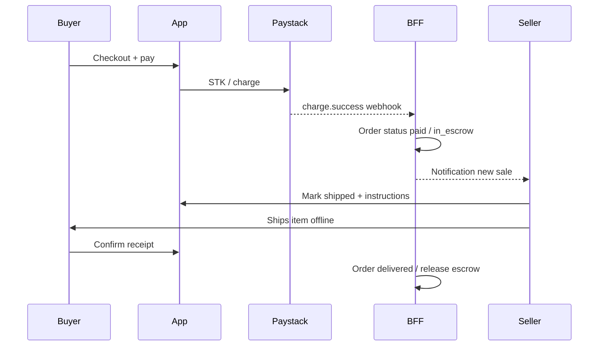

# Phase 3 — Work split (delivery, escrow, payments)

**Program gate:** [`PHASE3_GO_NO_GO.md`](./PHASE3_GO_NO_GO.md)  
**Roadmap:** [`TEAM_ROADMAP.md`](./TEAM_ROADMAP.md) § Phase 3  
**Duration:** ~5–6 weeks after Phase 2 checkout is green (scope now includes payout, refunds, notifications infra)

**Scope decision (2026-07-22):** Recommendations v1 is **deferred to a later phase** so all four of us can finish escrow together. The Phase 3 money core — state machine, migrations, payout, refunds, idempotency, reconciliation, notifications — is **split evenly across John, Shannon, Felix, and Brian**. The point is to make escrow genuinely safe: funds that are *held* must be able to *move* (payout) and *reverse* (refund), not just carry a status label.

This doc explains **how money and delivery should flow** (target procedure), **how buyers and sellers interact**, **what each person builds**, and the **gaps we pulled into Phase 3** (payout, refunds, reconciliation, real notifications, timers).

---

## Why Phase 3 exists

Phase 2 gets a buyer to **pay** and creates an **order** in the database. That is not enough for peer marketplace trust:

- The seller must know **payment succeeded** before shipping.
- The buyer needs **visibility** (paid → shipped → delivered).
- Funds should not “feel released” until the buyer **confirms receipt** (escrow-style flow — policy details in go/no-go C1–C4).

Phase 3 connects **Paystack/M-Pesa** (payment truth) to **order state** (product truth) and gives both sides **clear UI and notifications**. Without it, checkout works but post-purchase is opaque.

**Why it's a four-way split:** a safe escrow flow needs a durable data model, a single-writer state machine, real seller **payout**, a **refund** path, persistent idempotency, reconciliation, and real notifications. Rather than parking all of that on one person, we've divided the money core into four roughly equal tracks — foundation, buyer/payment truth, seller/payout, and notifications/timers/surfacing — so each of us owns both backend and UI and no single track blocks the rest.

---

## Target procedure: payment (buyer)

Applies to **catalog products** and **peer listings** once Phase 2 cart lines support listings.

### Test mode (`sk_test_…`)

| Step | What happens | System owner |
|------|----------------|--------------|
| 1 | Buyer enters cart → shipping → payment (M-Pesa or card). | Shannon — [`CartScreen`](../../apps/mobile/src/screens/CartScreen.tsx) |
| 2 | Client validates M-Pesa format (same rules as backend) before Place Order is enabled. | Shannon — [`mpesaPhone.ts`](../../apps/mobile/src/lib/mpesaPhone.ts) |
| 3 | **M-Pesa:** BFF `POST /v1/api/payments/mpesa/stk-push` → Paystack charge with `+254…` MSISDN. | Shannon — backend STK |
| 4 | Buyer approves STK on phone **or** uses Paystack sandbox test MSISDN `0710000000` (auto-success). Real Safaricom numbers on test keys → `MPESA_UNPROCESSED`. | Ops — [`mpesa-kenya-troubleshooting.md`](../payments/mpesa-kenya-troubleshooting.md) |
| 5 | App polls `GET /v1/api/payments/mpesa/requests/:id` until success/fail/timeout. | Shannon — M4-13 |
| 6 | **Only after payment success:** create order via orders RPC / repository (stock check). | Shannon |
| 7 | Paystack sends `charge.success` webhook → backend marks payment + order **paid** (Phase 3 — implement, not only log). | Shannon — [`paystack.ts`](../backend/handlers/webhooks/paystack.ts) |

### Live mode (`sk_live_…`)

Same flow; real STK on the buyer’s Safaricom line. Webhook + polling remain the source of truth if the app backgrounds during PIN entry.

### Card (interim)

Today: initialize Paystack transaction with buyer email; **full redirect/WebView** is M4-10. Card fields on cart are **local gating only** until redirect is wired.

---

## Target procedure: delivery and escrow (buyer ↔ seller)

LUKU v1 assumes **buyer-arranged delivery** (copy already on cart: “Arranged by buyer”). Phase 3 adds **state**, not a courier integration.

### Happy path (ideal)

| Phase | Order state (target) | Buyer sees | Seller sees |
|-------|----------------------|------------|-------------|
| Payment pending | `pending_payment` | “Check your phone…” / polling | — |
| Paid, in escrow | `paid` / `in_escrow` | Order confirmed; tracking stepper | **New order** notification; listing **Sold** |
| Shipped | `shipped` | “On the way” + seller notes if any | “Mark as shipped” done |
| Delivered | `delivered` | Prompt to **confirm receipt** | Waiting for buyer confirm |
| Complete | `completed` / released | Purchase history complete | **Payout** initiated to seller (Paystack subaccount/transfer) — Felix C-CORE-4 |
| Refunded | `refunded` | “Refunded” + reason | Sale reversed; listing may relist — Felix C-CORE-5 |
| Disputed | `disputed` | “Under review” | Ops-mediated hold — manual v1 |

Exact enum names, hold duration, auto-release window, and refund window come from the **escrow ADR** ([`ESCROW_POLICY.md`](../architecture/ESCROW_POLICY.md), go/no-go C1–C4). John owns the migration + `payments` table + reconciliation; Shannon owns the state machine + webhook writer + buyer stepper/confirm-receipt; Felix owns seller actions, payout, refunds, and copy; Brian owns notifications, timers, and surfacing.

### How buyer and seller interact

| Channel | Purpose | Owner |
|---------|---------|--------|
| **Order detail / tracking** | Single source of truth for status; buyer confirms receipt here. | Shannon (M4-09, C5) |
| **Push/in-app notifications** | Seller: “You sold …”; Buyer: “Shipped” / “Confirm delivery”. Backed by a **real notifications table + Expo push** (Brian infra), not synthesized. | Brian (infra) + Felix (seller copy) + Shannon (buyer token) |
| **Inbox (address exchange)** | Buyer’s shipping address / contact must reach the seller. If inbox is the channel it is **required**, not optional. | Shannon (address capture) + Felix (seller view) |
| **Off-platform** | Phone, courier, meet-up — **outside the app**; seller handoff copy sets expectations (Felix C6). | Felix |

**Disputes / refunds are now IN Phase 3 (scope change 2026-07-22).** Refunds get a real state + buyer entry point + manual ops path (Felix C-CORE-5). Full automated dispute mediation stays lightweight in v1: a **“report a problem”** entry that flags the order `disputed` and routes to manual ops — no automated adjudication yet.

---

## Gaps pulled into Phase 3 (owner map)

These were previously unowned or deferred. They are now first-class Phase 3 work, spread across all four of us. IDs prefixed `C-CORE-*` (money core) and `C-NOTIF-*` (notifications).

| # | Gap | Primary owner | Support |
|---|-----|---------------|---------|
| C-CORE-1 | Order-status migration + `payments` table + transition timestamps | John | Shannon (consumes) |
| C-CORE-2 | Escrow state machine: single-writer, authorization per transition | Shannon | John (schema), Felix |
| C-CORE-3 | Persistent (DB-backed) idempotency, replacing in-memory store | Shannon | John (schema) |
| C-CORE-4 | Payout / settlement (Paystack subaccounts or Transfers) + seller payout-details form | Felix | John (migration hooks) |
| C-CORE-5 | Refunds: `refunded` state + manual ops path + buyer “report a problem” | Felix | Shannon (buyer UI) |
| C-CORE-6 | Reconciliation / Verify-Transaction job for stuck orders | John | Shannon |
| C-CORE-7 | Timers: auto-release on no-confirm; ship-by / auto-cancel | Brian | Felix (seller copy) |
| C-CORE-8 | Multi-seller order splitting (1 payment → N escrows) or v1 single-seller restriction | John | Shannon |
| C-CORE-9 | KYC / compliance / escrow terms with Paystack | John (+ program/legal) | Felix (payout inputs) |
| C-CORE-10 | Observability: stuck-order metrics, webhook signature tests | Brian | Shannon |
| C-NOTIF-1 | Real notifications table + event writes on webhook | Brian | Felix (seller), Shannon (buyer) |
| C-NOTIF-2 | Push delivery (Expo token capture/storage/send) | Brian (send service) | Shannon (token registration) |
| — | Real shipping-address / contact capture (replace hardcoded value in `CartScreen`) | Shannon | Felix (seller view) |

**Sequencing note:** C-CORE-1 (John's migration/schema) unblocks the state machine, so it lands **week 1**; C-CORE-2/3 follow immediately. Start the Paystack subaccount / KYC conversation (C-CORE-4, C-CORE-9) on **day 1** — those have external lead times. No single person is a hard bottleneck: once the schema is up, buyer, seller, and notifications tracks proceed in parallel.

---

## Why each owner (what problem they solve)

### John — data foundation + reconciliation

| Why | What |
|-----|------|
| Everyone consumes the order data model; the schema needs to land first. | Migration + `payments` table + transition timestamps (C-CORE-1); `OrderDto` contract fields. |
| Money must self-heal after timeouts, races, or a missed webhook. | Reconciliation / Verify-Transaction job (C-CORE-6). |
| One payment can cover items from more than one seller. | Multi-seller decision: split escrows or v1 single-seller restriction (C-CORE-8). |
| Holding funds carries compliance obligations. | Escrow ADR C1–C4; seller KYC / settlement / terms conversation with Paystack (C-CORE-9). |

### Shannon (M4) — payment truth + buyer side

| Why | What |
|-----|------|
| Commerce owner ties **payment lifecycle** to **order state** safely (M4-13). | STK poll; order after success; **state machine** as single writer on `charge.success` (C-CORE-2). |
| Money events must survive restarts and duplicate webhooks. | DB-backed idempotency replacing the in-memory store (C-CORE-3). |
| Buyers need trustworthy errors and escrow visibility. | Checkout validation, order stepper, **Confirm receipt** (C5); refund / report-a-problem UI (C-CORE-5). |
| Sellers can only ship if they know where. | Real shipping-address / contact capture; push token registration (C-NOTIF-2). |

### Felix (M3) — seller side + money movement

| Why | What |
|-----|------|
| Held funds must be able to **move** and **reverse**, or escrow is a lie. | Payout via Paystack subaccounts/transfers (C-CORE-4); refund state + ops path (C-CORE-5). |
| Payout can't happen without a destination. | Seller **payout-details form** (settlement bank / M-Pesa). |
| Shipping is seller-driven in v1. | “Mark as shipped”, shipping handoff copy (C6), link order ↔ listing; sold listing rules (MP-12). |
| Reduces “I sold it but still see it listed” confusion. | Hide sold from wardrobe/feed when order is paid. |

### Brian (M2) — notifications, timers + surfacing

| Why | What |
|-----|------|
| Notifications are currently faked; sellers/buyers need real ones. | Notifications table + webhook writes (C-NOTIF-1); Expo push send service (C-NOTIF-2). |
| Escrow can deadlock without deadlines. | Auto-release / ship-by / auto-cancel timers + countdown UI (C-CORE-7). |
| Status hidden only on Order Tracking is easy to miss; ops must spot stuck money. | Purchase entry + escrow fields on Home/Discover; stuck-order **ops dashboard** (C-CORE-10). |
| Phase 3 QA needs stable discovery paths. | M2-03/M2-05 cleanup; MP-13 single add-to-cart. |

---

## Owners at a glance

| Person | Primary track | Branch suggestion |
|--------|---------------|-------------------|
| **John** | Data foundation: migration + `payments` table, contract fields, reconciliation job, multi-seller decision, compliance/KYC | `feature/phase3-order-schema` |
| **Shannon (M4)** | Payment truth: state machine (single writer), DB idempotency, buyer escrow UI, confirm receipt, refund UI, address capture, push token | `feature/phase3-escrow-buyer` |
| **Felix (M3)** | Seller + money movement: payout (subaccounts/transfers), payout-details form, refunds, ship actions, sold lifecycle, handoff copy | `feature/phase3-seller-payout` |
| **Brian (M2)** | Notifications + timers + surfacing: notifications table + push send, auto-release/cancel timers, order surfacing, ops dashboard | `feature/phase3-notify-surfacing` |

---

## John (M1) — data foundation + reconciliation

| Workstream | Tasks | ID |
|------------|-------|-----|
| Data model | Order-status migration (`paid`, `in_escrow`, `shipped`, `delivered`, `released`/`completed`, `cancelled`, `refunded`, `disputed`); `payments` table keyed by Paystack reference; per-transition timestamps | C-CORE-1 |
| Contracts | Escrow fields on `OrderDto`; shared types for state machine consumers | C-CORE-1 |
| Reconciliation | Verify-Transaction job for polling-timeout / webhook-race / paid-no-order repair | C-CORE-6 |
| Multi-seller | Decide + implement: split 1 payment → N escrows, or restrict v1 to single-seller checkout | C-CORE-8 |
| Compliance | Escrow ADR (C1–C4); seller KYC / settlement / escrow terms conversation with Paystack | C-CORE-9 |

**Sequencing:** land C-CORE-1 (schema + contracts) in **week 1** so Shannon's state machine and everyone's UI can build against it. Recommendations v1 is deferred (see [`TEAM_ROADMAP.md`](./TEAM_ROADMAP.md) § Phase 5).

---

## Shannon (M4) — payment truth + buyer escrow

| Workstream | Tasks | ID |
|------------|--------|-----|
| State machine | Single-writer transitions with per-actor authorization (seller ships, buyer confirms; can't confirm before shipped, ship before paid) | C-CORE-2 |
| Webhooks | Wire [`charge.success`](../backend/handlers/webhooks/paystack.ts) → state machine (no client-side status writes); **DB-backed** idempotency replacing [`idempotencyStore`](../../backend/payments/idempotencyStore.ts) | C-CORE-3 |
| Phase 2 debt | M4-13: poll M-Pesa; create order only after payment success | — |
| Buyer UX | Escrow states on order detail (M4-09), **Confirm receipt** (C5); refund / report-a-problem UI (with Felix) | C-CORE-5 |
| Address / push | Real shipping-address / contact capture (replaces hardcoded value in [`CartScreen`](../../apps/mobile/src/screens/CartScreen.tsx)); Expo push token registration | C-NOTIF-2 |
| QA | [`04_commerce_inbox_checklist.md`](../qa/04_commerce_inbox_checklist.md) §2.2–2.3 | — |

---

## Felix (M3) — seller delivery + money movement

| Workstream | Tasks | ID |
|------------|--------|-----|
| Payout | Paystack subaccounts / Transfers on release; seller **payout-details form** (settlement bank / M-Pesa) | C-CORE-4 |
| Refunds | `refunded` state handling + manual ops path; seller-side reversal on `disputed` | C-CORE-5 |
| Actions | “Mark as shipped” on the state-machine transition (seller-authorized); shipping handoff copy (C6) | — |
| Listings | MP-12: sold hidden from feed/wardrobe; order tied to listing | — |
| QA | [`03_MEMBER_WARDROBE_SELL.md`](./03_MEMBER_WARDROBE_SELL.md), go/no-go A5 | — |

---

## Brian (M2) — notifications, timers + surfacing

| Workstream | Tasks | ID |
|------------|--------|-----|
| Notifications infra | Real notifications table + event writes on webhook (replaces synthesized notifications); Expo push send service | C-NOTIF-1 |
| Timers | Auto-release on no buyer confirm; ship-by → auto-cancel + refund; reminder jobs + countdown UI | C-CORE-7 |
| Orders UI | Render escrow/delivery fields + countdowns on purchase history; purchase entry from Home/Discover | — |
| Observability | Stuck-order / paid-not-shipped **ops dashboard**; webhook signature tests | C-CORE-10 |
| Cleanup | M2-03 wishlist hydration, M2-05 duplicate keys; MP-13 single add-to-cart | — |

---

## Suggested timeline (~5–6 weeks)

The only hard ordering is John's schema first (week 1); after that the four tracks run in parallel.

| Week | John | Shannon | Felix | Brian |
|------|------|---------|-------|-------|
| 1 | Migration + `payments` table + `OrderDto` fields (C-CORE-1); ADR C1–C4 | Address capture; webhook stub vs new fields | Payout-details form spec; open Paystack subaccount req | Notifications table schema; contract-consumption spike |
| 2 | Reconciliation job scaffold (C-CORE-6) | State machine + single-writer webhook (C-CORE-2) | Payout wiring (subaccounts/transfers) (C-CORE-4) | Notifications writes on webhook (C-NOTIF-1) |
| 3 | Multi-seller decision + impl (C-CORE-8) | DB idempotency (C-CORE-3); buyer stepper | “Mark shipped” transition; sold lifecycle | Expo push send (C-NOTIF-2); escrow fields on cards |
| 4 | Reconciliation finish; KYC/compliance (C-CORE-9) | Confirm receipt; refund UI (with Felix) | Refund path (C-CORE-5); handoff copy | Auto-release/cancel timers (C-CORE-7) |
| 5 | Integration support | Integration + QA | Integration + QA | Countdowns + stuck-order dashboard (C-CORE-10) |
| 6 | Go/no-go re-run | Demo buyer happy path | Demo payout + refund | Demo notifications + timers |

**Day 1, in parallel:** open the Paystack subaccount / KYC / live-keys conversation (C-CORE-4, C-CORE-9) — external lead times can exceed the code work.

---

## Dependencies

| Artifact | Owner | Consumers |
|----------|-------|-----------|
| Order-status migration + `payments` table + `OrderDto` fields (C-CORE-1) | **John** | Shannon, Felix, Brian |
| Escrow state machine + single-writer webhook (C-CORE-2) | **Shannon** | Felix (transitions), Brian (events) |
| DB-backed idempotency (C-CORE-3) — replaces in-memory [`idempotencyStore`](../../backend/payments/idempotencyStore.ts) | **Shannon** | webhook path |
| Payout mechanism + seller payout-details (C-CORE-4) | **Felix** | John (migration hooks) |
| Notifications table + push send (C-NOTIF-1/2) | **Brian** | Felix (seller), Shannon (buyer token) |
| Push device token | **Shannon** | Brian (C-NOTIF-2) |
| Reconciliation job (C-CORE-6) | **John** | Shannon (payment states) |

---

## Related docs

- [`ESCROW_POLICY.md`](../architecture/ESCROW_POLICY.md) — escrow ADR (windows, payout rail, fees, multi-seller)
- [`PHASE3_TICKETS.md`](./PHASE3_TICKETS.md) — per-owner ticket breakdown with acceptance criteria
- [`mpesa-kenya-troubleshooting.md`](../payments/mpesa-kenya-troubleshooting.md) — test vs live M-Pesa
- [`integration-checklist.md`](../payments/integration-checklist.md) — Paystack enablement
