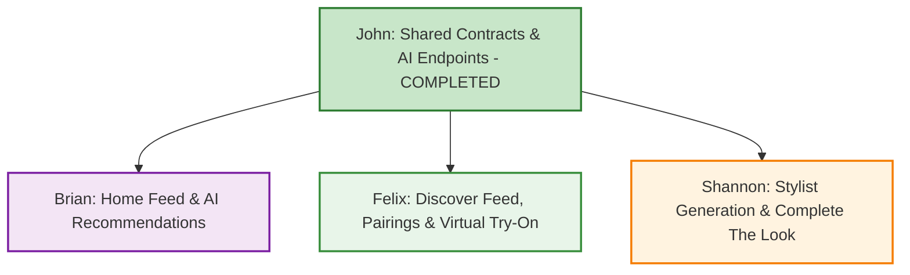

# Phase 4 & 5 — Team Deliverables & Ticket Guide

**Goal:** Turn LUKU into an AI-powered personal stylist and smart marketplace with a tight, focused MVP scope.  
**Program Owner:** John  
**Development Branch:** `zeus`  

### Task Status Tags Legend:
* 🟢 **`[START NOW]`** / 🟢 **`[READY TO INTEGRATE]`** — Completely unblocked! Backend contracts, endpoints, and client repositories are live and ready to connect.
* ✅ **`[COMPLETED]`** — Finished, verified, and passing all tests.

---

## Tight MVP Scope Boundary

Per product direction, MVP is strictly limited to our core recommendation & styling screens:
1. **AI Stylist Screen:** Prompt-based outfit generation from user descriptions, parameter-based recommendations, "Complete The Look" (shop the look unowned item with Add to Cart), "Style Enhancers" (% Match grid), and saving to favorites.
2. **Home Screen Recommendation Sections:**
   - **Outfit of the Day (OOTD):** Daily AI look (`Casual Chic Weekend · 22°C`) with Save, Try On, and New actions.
   - **"PICKED FOR YOU":** Hero match card with `% Match` badge and AI reason ("Complements your earth-tone wardrobe").
   - **"TRENDING NOW":** Horizontal rail of trending marketplace clothes.
   - **"YOU MIGHT ALSO LIKE":** 2-column grid of items recommended based on clothes in the user's wardrobe.
   - **"MORE FOR YOU":** Vertical recommendation list with personalized `% Match` badges.
3. **Discover Screen Recommendation Sections:**
   - **"PAIR WITH YOUR WARDROBE" Rail:** Horizontal cards with `% Match` and `with your {item.pairs}` displayed directly on the screen.
   - **Curated Discovery Feed (Underneath Pairings):** Recommending clothes filtered by user parameters (categories, brands, price, condition) and smart sorting.
4. **Virtual Try-On Studio:** Mannequin studio with body type & skin tone customization and outfit selector (accessible from Stylist and Home OOTD).

## Screen Navigation & Routing Reference

Use this cheat sheet to navigate directly to your screens in the app:

| Screen Name | File Path | Primary Owner | How to Navigate to It in the App |
|:---|:---|:---:|:---|
| **Stylist Screen** | `apps/mobile/src/screens/StylistScreen.tsx` | Shannon | Bottom Tab Bar ➔ Tap **`STYLIST`** (sparkles icon). |
| **Home Screen** | `apps/mobile/src/screens/HomeScreen.tsx` | Brian | Bottom Tab Bar ➔ Tap **`HOME`** (1st icon). |
| **Discover Screen** | `apps/mobile/src/screens/DiscoverScreen.tsx` | Felix | Bottom Tab Bar ➔ Tap **`DISCOVER`** (compass icon). |
| **Virtual Try-On Screen** | `apps/mobile/src/screens/VirtualTryOnScreen.tsx` | Felix & Shannon | **From Home:** Tap **`Try On`** on "Outfit of the Day" **From Stylist:** Tap purple camera icon on any outfit card (`rootNav.navigate('VirtualTryOn')`). |
| **Saved Outfits View** | `apps/mobile/src/screens/MeScreen.tsx` | Shannon | Bottom Tab Bar ➔ Tap **`ME`** ➔ Tap **`SAVED`** sub-tab (heart icon). |

---

## Team Workflow & Dependency Overview

* **Backend Foundation:** John has built and tested the shared data contracts, Ollama/Gemini model switcher, 2-step recommendation engines, and mobile repositories.
* **Frontend Execution:** Brian, Felix, and Shannon can wire up their respective screens immediately using the typed repository methods.

---

## 1. Shannon (Member 4) — AI Stylist Screen · `feature/phase4-stylist-ux`

**Your Goal:** Make the Stylist tab an interactive fashion companion that generates outfits from text descriptions, suggests parameter-based looks with "Complete The Look" items, and displays "Style Enhancers".

> **📍 How to Navigate to Your Screens:**
> - **Stylist Tab:** Bottom Tab Bar ➔ Tap **`STYLIST`** (sparkles icon) ([`StylistScreen.tsx`](file:///c:/Users/jjNgu/OneDrive/Desktop/luku/apps/mobile/src/screens/StylistScreen.tsx)).
> - **Virtual Try-On Launch:** On any outfit card, tap the purple **Camera icon** (`rootNav.navigate('VirtualTryOn')`).
> - **Saved Outfits Verification:** Bottom Tab Bar ➔ Tap **`ME`** ➔ Tap **`SAVED`** sub-tab (heart icon).

| Ticket ID | Status Tag | Feature Title | What You Need to Build | Why We Are Doing It |
|:---|:---:|:---|:---|:---|
| **M4-AI-1** | 🟢 **`[START NOW]`** | **Stylist Card Actions & Persistence** | In `StylistScreen.tsx`, wire the favorite heart button to save/remove outfits in the `outfits` table via `outfitsRepository`. Wire the Try-On camera button to navigate to `VirtualTryOn`. Wire the "Complete The Look" shopping bag button to call `addToCart(item.productId)`. | Allows users to keep looks in their Saved tab, try them on virtually, and purchase unowned missing pieces immediately. |
| **M4-AI-2** | 🟢 **`[READY TO INTEGRATE]`** | **Prompt-Based Outfit Generation** | Connect the existing "Describe Your Needs" prompt input and "Generate" button to `repositories.stylist.generateSuggestions({ occasion, description })` with loading spinner. | Generates fresh outfits mixing the user's owned clothes with catalog items based on custom text prompts. |
| **M4-AI-3** | 🟢 **`[READY TO INTEGRATE]`** | **Parameter-Based Outfits & Style Enhancers** | Connect default outfit recommendations (filtered by occasion/weather) and the "Style Enhancers" 2-column grid (`% Match` badge, name, price) to `repositories.stylist.generateSuggestions()`. | Replaces mock suggestions with real personalized wardrobe matches and style complements. |

---

## 2. Brian (Member 2) — Home Screen Recommendations · `feature/phase4-discovery-recs`

**Your Goal:** Wire up all Home screen recommendation sections so the experience feels deeply personalized from top to bottom.

> **📍 How to Navigate to Your Screens:**
> - **Home Screen:** Bottom Tab Bar ➔ Tap **`HOME`** (1st tab icon) ([`HomeScreen.tsx`](file:///c:/Users/jjNgu/OneDrive/Desktop/luku/apps/mobile/src/screens/HomeScreen.tsx)).

| Ticket ID | Status Tag | Feature Title | What You Need to Build | Why We Are Doing It |
|:---|:---:|:---|:---|:---|
| **M2-AI-1** | 🟢 **`[START NOW]`** | **Loading Skeletons & Section States** | In `HomeScreen.tsx`, ensure "Outfit of the Day", "PICKED FOR YOU", "TRENDING NOW", "YOU MIGHT ALSO LIKE", and "MORE FOR YOU" handle loading states smoothly using `ProductGridSkeleton`. | Prevents screen jumping and ensures a polished first impression on app open. |
| **M2-AI-2** | 🟢 **`[READY TO INTEGRATE]`** | **Outfit of the Day (OOTD) Integration** | Connect `HomeScreen.tsx` OOTD card to `repositories.home.getOotd()`. Wire the "Save" (Heart), "Try On" (Camera), and "New" (RefreshCw) buttons to live state. | Delivers a fresh daily look matching the weather and occasion with one-tap try-on and refresh. |
| **M2-AI-3** | 🟢 **`[READY TO INTEGRATE]`** | **"Picked For You" & Recommendation Rails** | Connect "PICKED FOR YOU" hero card directly in `HomeScreen.tsx` to `repositories.home.getRecommendations()`. Connect "YOU MIGHT ALSO LIKE" (based on wardrobe) and "MORE FOR YOU" (with `% Match` badges) to `repositories.home.getRecommendations()`. | Populates Home with tailored fashion recommendations matching the user's closet and aesthetic without leaving the feed. |

---

## 3. Felix (Member 3) — Discover Screen, Pairings & Virtual Try-On · `feature/phase4-tryon-pairings`

**Your Goal:** Connect the Discover wardrobe pairings rail, the parameter-based clothing recommendation feed underneath, and deliver the Virtual Try-On studio.

> **📍 How to Navigate to Your Screens:**
> - **Discover Screen:** Bottom Tab Bar ➔ Tap **`DISCOVER`** (compass icon) ([`DiscoverScreen.tsx`](file:///c:/Users/jjNgu/OneDrive/Desktop/luku/apps/mobile/src/screens/DiscoverScreen.tsx)).
> - **Virtual Try-On Studio:** Tap **`Try On`** on Home OOTD or the purple camera icon on any Stylist card ➔ opens [`VirtualTryOnScreen.tsx`](file:///c:/Users/jjNgu/OneDrive/Desktop/luku/apps/mobile/src/screens/VirtualTryOnScreen.tsx).

| Ticket ID | Status Tag | Feature Title | What You Need to Build | Why We Are Doing It |
|:---|:---:|:---|:---|:---|
| **M3-AI-1** | 🟢 **`[START NOW]`** | **Virtual Try-On Customization State** | In `VirtualTryOnScreen.tsx`, wire body type selector (`Petite`, `Slim`, `Athletic`, `Curvy`, `Plus Size`), skin tone palette, and outfit list selector to dynamically update the mannequin preview. | Provides a personalized visual studio for previewing how outfits look. |
| **M3-AI-2** | 🟢 **`[READY TO INTEGRATE]`** | **Discover "Pair With Your Wardrobe" Integration** | Connect `DiscoverScreen.tsx`'s horizontal rail to `repositories.wardrobePairings.list()` to populate the matching items and `% Match` badges directly on the Discover screen. | Shows real marketplace items that pair with pieces the user already has in their closet. |
| **M3-AI-3** | 🟢 **`[READY TO INTEGRATE]`** | **Parameter-Based Discovery Feed (Underneath Rail)** | In `DiscoverScreen.tsx`, wire the product feed underneath the pairing rail with filter parameters (Categories, Price, Condition, Brand) and match sorting so recommended clothes adapt dynamically. | Lets users discover clothes matching specific style and budget parameters. |
| **M3-AI-4** | 🟢 **`[READY TO INTEGRATE]`** | **Deep-Link Outfit into Virtual Try-On** | Handle route navigation params in `VirtualTryOnScreen.tsx` so tapping "Try On" from Home OOTD or Stylist automatically selects and loads that specific outfit. | Seamless transition from discovering an outfit to previewing it on the mannequin. |

---

## 4. John (Lead / AI Engineer) — Shared Architecture & Backend AI · `feature/phase4-ai-core`

**Your Goal:** Build the shared data contracts, multi-provider model router (Gemini, Ollama, Mock), and fast cached endpoints powering all recommendation sections.

> **📍 Core Backend Services & Route Mounts:**
> - Shared Contracts: `packages/contracts/src/ai/`
> - Provider Layer: `backend/ai/providers/` (`GeminiProvider`, `OllamaProvider`, `MockProvider`)
> - Task Engines: `backend/ai/tasks/` (`outfitSuggestions.ts`, `ootd.ts`, `recommendations.ts`, `wardrobePairings.ts`)
> - Express Routes: `backend/router/v1/ai/` mounted under `/v1/api/ai/*`
| Ticket ID | Status Tag | Feature Title | What You Need to Build | Why We Are Doing It |
|:---|:---:|:---|:---|:---|
| **AI-CORE-1** | ✅ **`[COMPLETED]`** | **Shared Data Contracts** | Define TypeScript DTOs in `packages/contracts/src/ai/`: `outfitSuggestions.ts` (descriptions, parameters, shop-the-look, enhancers), `ootd.ts`, `recommendations.ts`, `wardrobePairings.ts`. | Ensures mobile and backend agree on the exact data shapes before writing API hooks. |
| **AI-CORE-2** | ✅ **`[COMPLETED]`** | **Swappable AI Model Router** | `backend/ai/providers/` with `GeminiProvider`, `OllamaProvider` (Llama 3.2), and `MockProvider`. Switch via `AI_PROVIDER=gemini\|ollama\|mock`. | Lets developers run AI locally for free with Ollama, run offline with mocks, or use Gemini in prod. |
| **AI-CORE-3 & 4** | ✅ **`[COMPLETED]`** | **Recommendations & Pairings Endpoints** | Build `GET /v1/api/ai/recommendations` and `GET /v1/api/ai/wardrobe-pairings` in `backend/ai/tasks/` with fast database filtering + AI reranking and 2-hour caching. | Powers Brian's Home recommendation sections and Felix's Discover feed and pairings. |
| **AI-CORE-5** | ✅ **`[COMPLETED]`** | **Stylist Suggestions & OOTD Engine** | Build `POST /v1/api/ai/outfit-suggestions` and `GET /v1/api/ai/ootd` in `backend/ai/tasks/` combining wardrobe items with shop-the-look missing catalog items. | Powers Shannon's Stylist prompt generator and Brian's Home Outfit of the Day. |
| **AI-CORE-6** | ✅ **`[COMPLETED]`** | **Automated Test Suite** | Vitest test suites in `backend/ai/tasks/*.test.ts` using `MockProvider`. Run via `npm test`. | Guarantees all AI additions work reliably without breaking payments or escrow. |
---

## Definition of Done (Checklist for Merging to `zeus`)

- [x] All new routes return the standard `{ data, error, message, status }` response.
- [x] No mobile code imports `@google/genai` or exposes `GEMINI_API_KEY`.
- [x] Setting `AI_PROVIDER=ollama` runs the full flow locally without cloud keys.
- [x] Only existing MVP screen layouts and UI components are wired up — all non-MVP features deferred.
- [x] `npm run lint:mobile` (`tsc --noEmit`) passes cleanly.
- [x] `npm run typecheck:backend` (`tsc --noEmit`) passes cleanly.
- [x] `npm run typecheck:contracts` passes cleanly.
- [x] All 70 existing test suites (`npm test`) remain green.

