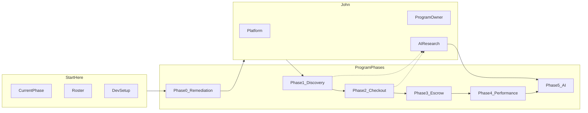

# LUKU mobile — team roadmap (Phase 3 program)

**Share this doc with the team.** It is the single entry point for where we are, who owns what, and how to start today.

| Field | Value |
|-------|-------|
| **Program** | Phase 3 — post–Phase 2 merge on `zeus` |
| **Current phase** | **Phase 0** — Remediation closeout |
| **Platform lead** | John |
| **Program owner** | John |
| **Last updated** | 2026-07-03 (team go OPEN) |

---

## Team go status

| | |
|---|---|
| **Status** | **OPEN** — platform PR merged to `zeus` (2026-07-03) |
| **Live task status** | [`PHASE0_STATUS.md`](./PHASE0_STATUS.md) |
| **John pre-flight** | [`TEAM_GO_CHECKLIST.md`](./TEAM_GO_CHECKLIST.md) |

Brian, Felix, Shannon: **`git checkout zeus && git pull`**, then open your fix branch below.

---

## Member cards — start after team go

### Brian (M2)

| | |
|---|---|
| **Branch** | `fix/m2-catalog-qa` |
| **Spec** | [`02_MEMBER_CATALOG.md`](./02_MEMBER_CATALOG.md) |
| **QA** | [`02_member_catalog_checklist.md`](../qa/02_member_catalog_checklist.md) |
| **Already on `zeus` after merge** | M2-01 (wishlist repo), M2-04 (add-to-cart toast) |
| **Smoke failures** | M2-03 wishlist display; M2-05 duplicate keys on ProductDetail |
| **Do next (in order)** | 1. **M2-05** — dedupe Similar items keys on `ProductDetailScreen.tsx` · 2. **M2-03** — hydrate wishlist rows · 3. **M2-07** — remove duplicate Buy Now |
| **Do not touch** | `CartScreen`, wardrobe/listings, inbox, payments |

### Felix (M3)

| | |
|---|---|
| **Branch** | `fix/m3-wardrobe-sell-qa` |
| **Spec** | [`03_MEMBER_WARDROBE_SELL.md`](./03_MEMBER_WARDROBE_SELL.md) |
| **Already on `zeus` after merge** | M3-01 (duplicate listing guard) |
| **Verify first (QA)** | M3-02 resume listing · M3-03 hide/badge listed items · M3-04 no duplicate wardrobe row · M3-05 mark sold persists |
| **Do next (in order)** | 1. **M3-14** — `ListForSaleSheet.tsx` spinner inside `GradientButton` · 2. Fix any failed verify items · 3. M3-06 button loading UX |
| **Do not touch** | cart, orders, wishlist routes, payments |

### Shannon (M4)

| | |
|---|---|
| **Branch** | `fix/m4-commerce-inbox-qa` |
| **Spec** | [`04_MEMBER_COMMERCE_INBOX.md`](./04_MEMBER_COMMERCE_INBOX.md) |
| **QA** | [`04_commerce_inbox_checklist.md`](../qa/04_commerce_inbox_checklist.md) |
| **Already on `zeus` after merge** | M4-01 (cart tenant), M4-07 (no active now), M4-08 (Stylist API) |
| **Smoke failures** | M4-03 partial (envelope OK); M4-13 no STK prompt / no poll before order |
| **Do next (in order)** | 1. **M4-13** — M-Pesa STK prompt + poll before order · 2. **M4-11** — optimistic cart +/- · 3. **M4-12** — disable minus at qty 1 · 4. **M4-02** — finish clear/remove UX · 5. **M4-06** inbox polish |
| **Do not touch** | wardrobe/listings CRUD, wishlist catalog routes, auth screens |

### John (M1 — after platform merge)

| | |
|---|---|
| **Branch** | `fix/m1-auth-profile-qa` |
| **Spec** | [`01_MEMBER_AUTH_PROFILE.md`](./01_MEMBER_AUTH_PROFILE.md) |
| **Already on `zeus` after merge** | M1-01 (profile photo), M1-08 (logout reset via PLT-01) |
| **Do next (in order)** | 1. **M1-02** verify logout → Sign In · 2. **M1-03** unconfirmed → Verify OTP · 3. **M1-05** seller profile from product detail |
| **Platform first** | [`TEAM_GO_CHECKLIST.md`](./TEAM_GO_CHECKLIST.md) before team go |

---

## Program status

| Phase | Name | Entry gate | Exit gate | Target branch | Sign-off | Blocked by |
|-------|------|------------|-----------|---------------|----------|------------|
| **0** | Remediation closeout | M1–M4 on `zeus` | Platform PR merged; all P0 closed | `fix/zeus-integration` → `zeus` | | Platform P0 |
| 1 | Unified discovery feed | Phase 0 on `zeus` | Peer listings on Home/Discover; pagination | `feature/marketplace-feed` | | |
| 2 | Peer cart & checkout | Phase 1 live | Buy listing end-to-end; auto-sold; seller notify | `feature/peer-checkout` | | |
| 3 | Delivery & escrow | Phase 2 works | Buyer confirms receipt; funds release | `feature/escrow` | | |
| 4 | Performance sprint | Phase 3 (or checkout min.) | Exit criteria met | `fix/perf-sprint` | | |
| 5 | AI integration | John delivers AI ADR | Recommended rail on Home/Discover | `feature/rec-v1` | | |



---

## Team roster

| Role | Name | Primary zones | Lead phases |
|------|------|---------------|-------------|
| **John — M1 + platform lead + program owner** | John | **Platform:** `apiClient`, `repositories/index.ts`, migrations, ADRs, `backend/server.ts`. **M1:** auth, profile, connections, Me. **Program:** decisions, phase sign-off. **Phase 3:** shares the money core with the team (order schema, reconciliation, ADR). AI/recommendations research deferred until after Phase 3. | 0 (platform first, then M1), 1, 3, 4, 5 + all gates |
| M2 — Brian | Brian | Home, Discover, search, wishlist | 0, 1, 4, 5 |
| M3 — Felix | Felix | Wardrobe, outfits, listings, sell UX | 0, 1–2, 4 |
| M4 — Shannon | Shannon | Cart, checkout, orders, inbox, payments | 0, 2–4, 5 |

### John's three hats

| Hat | Ask John for | Branch / doc |
|-----|--------------|--------------|
| **Platform lead** | Integration PRs, repo wiring, migrations, ADR review, "can I touch `repositories/index.ts`?" | `fix/zeus-integration`; [`00_PLATFORM_GATE.md`](./00_PLATFORM_GATE.md) |
| **Program owner** | Scope, product decisions, phase gates, kickoff | This doc; sign-off tables |
| **M1 implementer** | Auth/profile bugs and features in M1 zone only | `fix/m1-auth-profile-qa`; [`01_MEMBER_AUTH_PROFILE.md`](./01_MEMBER_AUTH_PROFILE.md) |

### Platform rules (Brian, Felix, Shannon)

- Do **not** edit [`repositories/index.ts`](../../apps/mobile/src/repositories/index.ts), [`apiClient.ts`](../../apps/mobile/src/api/apiClient.ts), or `database/migrations/` without John (platform) review.
- Need a new repo key wired? Open a PR tagged `[Platform]` or ask John to add wiring in integration.
- Member PRs stay in [merge zones](../qa/ZEUS_REMEDIATION.md#merge-zones-do-not-cross).
- **Phase 0:** wait for `fix/zeus-integration` merge before opening `fix/m{N}-*` branches.

### John's Phase 0 sequencing

1. **First:** Platform only — `fix/zeus-integration`, PLT-01–03 (P0), merge to `zeus`.
2. **Then:** Post **"team go"** — Brian/Felix/Shannon branch in parallel.
3. **Then:** John opens `fix/m1-auth-profile-qa` (separate PR, M1 zone only).
4. **Parallel (time-boxed):** Kickoff + sign-off; AI research notes (non-blocking).

### Which doc is source of truth?

| Scope | Doc |
|-------|-----|
| **Phase 0 tasks (detail)** | [`ZEUS_REMEDIATION.md`](../qa/ZEUS_REMEDIATION.md) |
| **Phase 0 live status** | [`PHASE0_STATUS.md`](./PHASE0_STATUS.md) |
| **Phase 0 platform steps** | [`ZEUS_EXECUTION_PLAN.md`](../qa/ZEUS_EXECUTION_PLAN.md) |
| **Phase 1+ program & marketplace** | This doc + [`MARKETPLACE_EPIC.md`](./MARKETPLACE_EPIC.md) |
| **Phase 3 entry sign-off** | [`PHASE3_GO_NO_GO.md`](./PHASE3_GO_NO_GO.md) |
| **Member file zones** | [`01`](./01_MEMBER_AUTH_PROFILE.md)–[`04`](./04_MEMBER_COMMERCE_INBOX.md) member specs |

**Note:** For Phase 1+, this roadmap supersedes "peer checkout out of scope" in [`02_MEMBER_CATALOG.md`](./02_MEMBER_CATALOG.md) and [`04_MEMBER_COMMERCE_INBOX.md`](./04_MEMBER_COMMERCE_INBOX.md).

---

## Start today

### Brian, Felix, Shannon (Phase 0)

**Blocked until team go.** When John announces:

1. Read [Member cards](#member-cards--start-after-team-go) above for your next tasks.
2. `git checkout zeus && git pull`
3. Run [dev setup](#dev-setup).
4. Open [`PHASE0_STATUS.md`](./PHASE0_STATUS.md) — find your **Pending** / **Verify** rows.
5. Create your branch (`fix/m2-catalog-qa`, `fix/m3-wardrobe-sell-qa`, or `fix/m4-commerce-inbox-qa`).
6. Before PR: `npm run lint:mobile` + your QA checklist; tag John if touching shared types.

### John (Phase 0 — in order)

1. Run [`TEAM_GO_CHECKLIST.md`](./TEAM_GO_CHECKLIST.md) (automated + smoke + PR merge).
2. Update [`PHASE0_STATUS.md`](./PHASE0_STATUS.md) → Team go **OPEN**.
3. Post team go message (template in checklist).
4. Branch `fix/m1-auth-profile-qa` for remaining M1 work.
5. Time-box: [kickoff agenda](./DISTRIBUTION.md#kickoff-agenda-30-min).

---

## Onboarding

### Read order (all members)

1. [`../architecture/ADR.md`](../architecture/ADR.md)
2. [`../architecture/BFF_OVERVIEW.md`](../architecture/BFF_OVERVIEW.md)
3. [`../database/TABLE_SCOPE.md`](../database/TABLE_SCOPE.md)
4. [`../api/CONTRACT_MATRIX.md`](../api/CONTRACT_MATRIX.md)
5. [`LEGACY_REFERENCE_GUIDE.md`](./LEGACY_REFERENCE_GUIDE.md)
6. Your member spec: [`01`](./01_MEMBER_AUTH_PROFILE.md) (John), [`02`](./02_MEMBER_CATALOG.md) (Brian), [`03`](./03_MEMBER_WARDROBE_SELL.md) (Felix), [`04`](./04_MEMBER_COMMERCE_INBOX.md) (Shannon)
7. [`PR_CHECKLIST.md`](./PR_CHECKLIST.md)
8. [`../../apps/mobile/docs/MOCK_DATA_POLICY.md`](../../apps/mobile/docs/MOCK_DATA_POLICY.md)

### Dev setup

```bash
# Repo root
cp .env.example .env.local   # add SUPABASE_SERVICE_ROLE_KEY from dashboard
npm install
npm run db:seed              # if fresh dev DB
npm run dev:api

# Mobile (separate terminal)
cd apps/mobile
# .env: EXPO_PUBLIC_USE_MOCK_DATA=false, EXPO_PUBLIC_API_BASE_URL=http://<LAN-IP>:3001
npm run start
```

**Integration mode:** `EXPO_PUBLIC_USE_MOCK_DATA=false`  
**Seed login:** `dev+buyer@luku.app` / `LukuDev2026!` — see [`database/seeds/dev_seed.sql`](../../database/seeds/dev_seed.sql)

**Verify before PR:**

```bash
npm run lint:mobile
npm run verify:deps
npm test
npm run verify:gate   # API must be running
```

**Branch hygiene:** one member zone per PR. Hot file `repositories/index.ts` — **John (platform) only**.

---

## Commerce model (FAQ)

| Question | Answer |
|----------|--------|
| What ships today? | **Catalog** (`products` ← `business_accounts`) has Discover/Home + checkout. **Peer** (`listings` ← wardrobe) is sell-only — not in feeds, no checkout. |
| What are we building? | Unified **MarketplaceItem** in Discover/Home/cart/checkout — peer listings as a first-class purchasable item. See [`MARKETPLACE_EPIC.md`](./MARKETPLACE_EPIC.md). |
| Business accounts? | **Seeds/scripts only** for MVP — no admin portal. |
| Manual sold vs auto-sold? | **Remediation:** manual mark sold until peer checkout (Phase 2). **Long-term:** auto-sold on payment. See [product decisions](../qa/ZEUS_REMEDIATION.md#product-decisions-locked-before-code). |

---

## Phase 0 — Remediation closeout (NOW)

**Goal:** Close P0/P1 QA failures without cross-member merge conflicts.  
**Duration:** ~1 week  
**Team start signal:** John posts "team go" when `fix/zeus-integration` is on `zeus`.

| Role | Start here | Key IDs | Branch | Order |
|------|------------|---------|--------|-------|
| **John (platform)** | [`ZEUS_EXECUTION_PLAN.md`](../qa/ZEUS_EXECUTION_PLAN.md) | PLT-01–05 | `fix/zeus-integration` | **1 — blocks team** |
| M2 Brian | [Remediation § M2](../qa/ZEUS_REMEDIATION.md#m2--brian-catalog--discovery) + [QA checklist](../qa/02_member_catalog_checklist.md) | M2-01–07 | `fix/m2-catalog-qa` | **2 — after platform merge** |
| M3 Felix | [Remediation § M3](../qa/ZEUS_REMEDIATION.md#m3--felix-wardrobe-outfits-peer-listings) | M3-01–13, M3-14 | `fix/m3-wardrobe-sell-qa` | **2 — after platform merge** |
| M4 Shannon | [Remediation § M4](../qa/ZEUS_REMEDIATION.md#m4--shannon-cart-checkout-orders-inbox-stylist) + [QA checklist](../qa/04_commerce_inbox_checklist.md) | M4-01–12 | `fix/m4-commerce-inbox-qa` | **2 — after platform merge** |
| **John (M1)** | [Remediation § M1](../qa/ZEUS_REMEDIATION.md#m1--john-auth-profile-social) | M1-01–08 | `fix/m1-auth-profile-qa` | **3 — after platform merge** |

### Phase 0 task summary by member

**John (platform) — PLT-*

| ID | Priority | Task |
|----|----------|------|
| PLT-01 | P0 | Logout clears AppState; refetch on login |
| PLT-02 | P0 | Checkout ApiError 201 — payment envelope |
| PLT-03 | P0 | `repositories/index.ts` audit — all `createApi*` wired |
| PLT-04 | P1 | Vitest / CI react module resolution |
| PLT-05 | P2 | Remove dev `console.log` in mobile API/screens |

**John (M1) — M1-*

| ID | Priority | Task |
|----|----------|------|
| M1-01 | P0 | Profile photo on Me |
| M1-02 | P0 | Logout → Sign In |
| M1-03 | P1 | Unconfirmed login → Verify OTP |
| M1-04 | P1 | Password reset flow |
| M1-05 | P1 | Seller UserProfile from product detail |
| M1-06 | P2 | Follow/unfollow instant tally |
| M1-07 | P2 | Seed blocked accounts for QA |
| M1-08 | P0 | Coordinate logout cart reset (PLT-01) |

**Brian (M2) — M2-*

| ID | Priority | Task |
|----|----------|------|
| M2-01 | P0 | `createApiWishlistRepository` wired |
| M2-02 | P1 | Discover pagination / infinite scroll |
| M2-03 | P1 | Wishlist sync across screens |
| M2-04 | P1 | Add to cart: toast, no navigate to Cart |
| M2-05 | P1 | Fix duplicate React keys in product lists |
| M2-06 | P2 | BrandDetail / StyleDetail API feeds |
| M2-07 | P1 | **Remove duplicate Buy Now** — single Add to Cart on ProductDetail |

**Felix (M3) — M3-*

| ID | Priority | Task |
|----|----------|------|
| M3-01 | P0 | Block duplicate active listing |
| M3-02 | P0 | Resume listing (Draft → Active) |
| M3-03 | P0 | Hide or badge listed items in wardrobe |
| M3-04 | P0 | Return to wardrobe — no duplicate row |
| M3-05 | P0 | Mark as sold persists after reload |
| M3-06–13 | P1/P2 | Loading UX, description, photos, outfit picker, skeletons, double-tap, inspiration |
| M3-14 | P1 | **ListForSaleSheet:** spinner inside `GradientButton`, not below |

**Shannon (M4) — M4-*

| ID | Priority | Task |
|----|----------|------|
| M4-01 | P0 | Cart tenant isolation after logout/login |
| M4-02 | P0 | Delete line, qty min 1, Clear cart |
| M4-03 | P0 | Checkout M-Pesa/card — no ApiError 201 |
| M4-04 | P0 | Coordinate PLT-02 |
| M4-05 | P1 | Hide shipping UI; buyer-arranged delivery copy |
| M4-06 | P1 | Inbox polish — avatar, time, unread, read receipts |
| M4-07 | P1 | Remove incorrect "active now" |
| M4-08 | P1 | Stylist → live AI API |
| M4-09–10 | P2 | Orders grouping; card checkout full pass |
| M4-11 | P1 | **Cart optimistic updates** — UI responds immediately; per-row loading on sync |
| M4-12 | P1 | **Disable minus at qty 1** — greyed out; use Remove instead |

---

## Phase 1 — Unified discovery feed (~2 weeks)

**Goal:** Peer **Active** listings appear alongside catalog products on Home/Discover/search.  
**Gate in:** Phase 0 merged to `zeus`  
**Gate out:** Paginated unified feed; wishlist works on unified items  
**Detail:** [`MARKETPLACE_EPIC.md`](./MARKETPLACE_EPIC.md)

| Role | Tasks | IDs |
|------|-------|-----|
| **John (platform)** | `MarketplaceItem` DTO; RPC `search_marketplace_paginated`; contract matrix | MP-01, MP-02 |
| M2 Brian | Feed UI, unified card, search/filters, wishlist on unified items | MP-03, MP-04 |
| M3 Felix | Sold/paused listings drop from feed; sell flow unchanged | MP-06 |
| **John (M1)** | Real seller name/avatar on cards (not `productAdapter` placeholder) | MP-05 |
| M4 Shannon | No checkout changes yet | — |

---

## Phase 2 — Peer cart and checkout (~2–3 weeks)

**Goal:** Buy peer listings in-app; auto-sold; seller notification v1.  
**Gate in:** Phase 1 feed live  
**Gate out:** End-to-end peer purchase; listing → Sold on payment  
**Backlog:** BL-05

| Role | Tasks | IDs |
|------|-------|-----|
| M4 Shannon | Cart/order RPCs for `listing_id`; payment; seller notify | MP-10, MP-11 |
| M3 Felix | Auto sold on payment; hide from wardrobe rules | MP-12 |
| M2 Brian | Single Add to cart path on product/listing detail | MP-13 |
| **John (platform)** | Order schema migration; envelope consistency | MP-14 |
| **John (M1)** | Inbox thread from listing purchase (optional v1) | MP-15 |

---

## Phase 3 — Delivery and escrow (~3–4 weeks)

**Goal:** Buyer confirms receipt; funds **held → released to seller** or **refunded**.  
**Gate in:** Phase 2 peer checkout works  
**Gate out:** Escrow states + payout + refund implemented in UI and backend  
**Backlog:** BL-02  
**Go/no-go:** [`PHASE3_GO_NO_GO.md`](./PHASE3_GO_NO_GO.md)  
**Work split (roles, payment/delivery procedure, buyer–seller flow):** [`PHASE3_WORK_SPLIT.md`](./PHASE3_WORK_SPLIT.md)

**Scope change (2026-07-22):** Recommendations v1 **deferred** (see Phase 5) so the whole team completes escrow together. The money core is **split evenly across all four members** — foundation, buyer/payment truth, seller/payout, and notifications/timers/surfacing. Duration extends to **~5–6 weeks**. Detail: [`PHASE3_WORK_SPLIT.md`](./PHASE3_WORK_SPLIT.md).

| Role | Tasks |
|------|-------|
| **John (M1)** | Order migration + `payments` table + `OrderDto` fields, reconciliation job, multi-seller decision, escrow ADR, KYC/compliance (C-CORE-1/6/8/9) |
| M4 Shannon | State machine (single writer) + DB idempotency, escrow buyer UI, confirm receipt (M4-09), refund UI, address capture, push token (C-CORE-2/3/5) |
| M3 Felix | Payout (Paystack subaccounts/transfers) + payout-details form, refunds, seller shipping handoff, sold listing lifecycle (C-CORE-4/5) |
| M2 Brian | Notifications table + push send, auto-release/cancel timers, order/delivery surfacing, stuck-order ops dashboard (C-NOTIF-1/2, C-CORE-7/10) |

---

## Phase 4 — Performance and stability sprint (~1–2 weeks)

**Goal:** App feels fast on real devices; BFF feed is paginated and indexed.  
**Gate in:** Phase 3 complete (minimum: catalog + peer checkout)  
**Gate out:** Exit criteria below met

| Role | Tasks |
|------|-------|
| M2 Brian | List virtualization, image sizing, feed cache |
| M4 Shannon | Cart optimistic paths hardened, debounced sync |
| M3 Felix | Wardrobe/listing list perf, upload compression |
| **John (M1)** | Profile/inbox list polish |
| **John (platform)** | DB indexes, BFF p95 check, slow-query pass |

**Exit criteria:**

- Discover first page: skeleton → content, paginated
- Cart +/- : UI updates in under 100ms; API sync in background
- BFF marketplace list p95 under 500ms on staging seed data

Also close **M2-02 pagination** if not done in Phase 1.

---

## Phase 5 — AI integration sprint (~2 weeks)

**Goal:** "For you" rail on Home/Discover from rules/SQL scoring; Stylist stays on Gemini.  
**Gate in:** John delivers AI ADR + API contract  
**Gate out:** Recommended rail live; eval plan run  
**Backlog:** BL-01, BL-06

**Deferred (2026-07-22):** Recommendation research is **no longer running in parallel during Phases 1–3** — the team is focused on completing Phase 3 escrow together. This phase (and its research/ADR) starts **after** Phase 3 escrow is signed off. Timeline shifts accordingly.

| Role | Tasks |
|------|-------|
| **John (program owner)** | ADR, signals list, eval plan — research in parallel during Phases 1–2 |
| M2 Brian | `recommended=true` rail, cold-start empty states |
| M4 Shannon | Stylist stays on `POST /v1/api/ai/outfit-suggestions` |
| **John (platform)** | Scoring SQL or service hook |

**John's parallel AI research (non-blocking until Phase 5):**

- Read [`../architecture/AI_PROVIDER.md`](../architecture/AI_PROVIDER.md)
- Optional spec: `docs/product/RECOMMENDATIONS_V1.md` (create during Phases 1–2)

---

## Backlog and deferred

| ID | Task | Owner | Phase |
|----|------|-------|-------|
| BL-01 | Recommendation engine v1 | John + M2 | 5 |
| BL-02 | Escrow — pay → ship → confirm → release | M4 + John | 3 |
| BL-03 | Multi-photo wardrobe + listing galleries | M3 | Backlog |
| BL-04 | Custom outfit cover picker | M3 | Backlog |
| BL-05 | Peer listing checkout → auto sold | M4 + M3 | 2 |
| BL-06 | Rec engine on catalog rails; keep Gemini for Stylist | John + M4 | 5 |
| — | Business admin portal | Deferred | Seeds only |
| — | Virtual try-on | Deferred | [`rn-v1-scope`](../product/rn-v1-scope.md) Phase 2 |

---

## Merge zones and PRs

Full path table: [`ZEUS_REMEDIATION.md` § Merge zones](../qa/ZEUS_REMEDIATION.md#merge-zones-do-not-cross).

**PR title convention:** `[Phase0|M2] M2-07: Remove Buy Now duplicate`

**PR template:** copy from [`ZEUS_REMEDIATION.md` § PR template](../qa/ZEUS_REMEDIATION.md#pr-template-copy-into-each-fix-pr).

---

## Sign-off

| Phase | Completed | Date | Signed by | Notes |
|-------|-----------|------|-----------|-------|
| 0 — Remediation | | | John | Platform PR: `fix/zeus-integration` |
| 1 — Discovery | | | John | |
| 2 — Peer checkout | | | John | |
| 3 — Escrow | yes | 2026-09-23 | John | Transfers deferred until business registration; EAS `projectId` pending. Evidence: `npm test` (553), `verify:escrow-pass`, `verify:order-api` + `--peer`. |
| 4 — Performance | | | John | |
| 5 — AI integration | | | John | |

Phase 0 detail: [`ZEUS_REMEDIATION.md` § Sign-off](../qa/ZEUS_REMEDIATION.md#sign-off-record)

---

## Changelog

| Date | Change |
|------|--------|
| 2026-07-22 | Phase 3 scope change: recommendations deferred; money core (escrow, payout, refunds, notifications infra) split evenly across all four members. Phase 5 no longer runs in parallel. |
| 2026-07-03 | Team go doc refresh — member cards, PHASE0_STATUS, TEAM_GO_CHECKLIST |
| 2026-07-03 | Initial roadmap — John as M1 + platform + program owner; Phases 0–5 |
