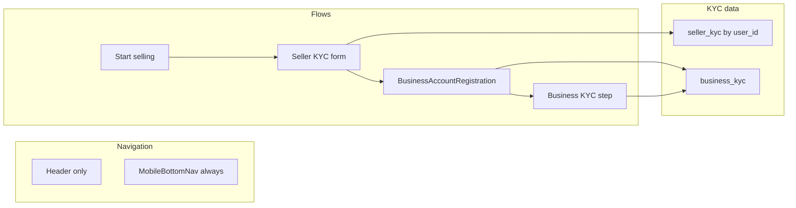

# KYC and Primary Bottom Nav Implementation Plan

## Part 1: Business KYC storage – pros and cons

Two ways to store business KYC (legal name, address, registration number, representative name/phone):

**Option A: Add KYC columns to `business_accounts` (business_accounts + seller_kyc)**

- **Pros**
  - Single table: one read/write for business + KYC; no joins.
  - Simpler RLS: existing `business_accounts` policies apply; no new table policies.
  - Fewer migrations and less code (no `business_kyc` service/slice).
  - Good fit if business KYC is always required and you never expose raw KYC to public APIs (you already restrict who can update `business_accounts`).
- **Cons**
  - Mixes public shop info (name, logo, contact_email) with sensitive data (legal name, address, rep phone); any broad SELECT on `business_accounts` must be careful not to leak KYC.
  - Harder to later restrict "sensitive" columns to a separate, tightly-audited surface (e.g. backend-only or separate service).
  - Table grows wider; if you add more KYC fields later, `business_accounts` becomes the catch-all.

**Option B: Separate `business_kyc` table (business_kyc + seller_kyc)**

- **Pros**
  - Clear separation: `business_accounts` stays public/shop-facing; KYC is only in `business_kyc`.
  - Easier to apply stricter access (e.g. RLS that limits `business_kyc` to owner or backend; never select it in public marketplace queries).
  - Better for compliance storytelling: "sensitive data lives in one table" with dedicated policies and optional encryption/audit.
  - Easier to extend (e.g. document uploads, verification status) without touching `business_accounts`.
- **Cons**
  - Extra table, migration, and RLS; every "business onboarding" flow must write two tables (or use a DB trigger/function to keep them in sync).
  - Slightly more app code: second slice or service for `business_kyc`, and you need to join or fetch KYC when you need it (e.g. payouts, support).

**Chosen: Option B** – Use a separate `business_kyc` table. Personal-seller identity KYC stays in **seller_kyc** (keyed by `user_id`).

---

## Part 2: Implementation plan

### 2.1 Make mobile bottom nav the only primary navigation

**Files:** App.tsx

- **Remove** the desktop-only top tab bar: delete the block under `{!isMobile && ( ... )}` (lines 605–702) that renders the horizontal nav with `TabButton` and `MoreMenu`. Do not render this for any viewport.
- **Always render** MobileBottomNav: change the condition from `{isMobile && (...)}` to always rendering `MobileBottomNav` (e.g. remove the `isMobile` check so it shows on all screen sizes).
- **Layout:** Apply bottom padding to `main` whenever the bottom nav is present (e.g. keep or generalize the `pb-24` class so content does not sit under the bar on all viewports). Optionally add a single `isMobile`-based class only for extra spacing on small screens if needed.
- **Header:** Keep Header as-is (logo, cart, wishlist, sign out). No duplicate tab list in the header.

Result: one navigation pattern (bottom nav + "More" sheet) for everyone; mobile bottom nav is the only primary navigation.

---

### 2.2 Database: seller_kyc and business KYC

**New migration file** (e.g. under `database/`):

**seller_kyc (personal sellers)**

- Table: `seller_kyc` with `user_id uuid not null references auth.users on delete cascade`, `legal_name text not null`, `phone text not null`, `address_line1`, `city`, `state_region`, `postal_code`, `country` (all not null for required fields), optional `date_of_birth date`, `id_type text`, `id_number text`, `created_at`, `updated_at`.
- Unique on `user_id` (one KYC record per user).
- RLS: only the owner (`auth.uid() = user_id`) can select/insert/update; no public select.

**Business KYC (Option B – chosen):**

- New table `business_kyc` with `business_id uuid not null references public.business_accounts on delete cascade`, `legal_entity_name text not null`, `business_address` (e.g. jsonb or columns: address_line1, city, state_region, postal_code, country), `registration_number text`, `representative_legal_name text not null`, `representative_phone text not null`, `created_at`, `updated_at`. Unique on `business_id`.
- RLS: only the user who owns the business (join via `business_accounts.user_id = auth.uid()`) can select/insert/update; no public select.

Add indexes/RLS as needed.

**Run migration:** After applying the ecommerce schema, run the KYC migration in Supabase: open **Supabase Dashboard → SQL Editor**, paste the contents of `database/kyc_schema.sql`, and run it. This creates `seller_kyc` and `business_kyc` with RLS. The app expects these tables to exist before using Seller KYC or Business KYC flows.

---

### 2.3 Types and state

**Files:** types.ts, new slice or extend existing

- Add TypeScript types: `SellerKyc` (user_id, legal_name, phone, address fields, optional dob/id_type/id_number, timestamps). `BusinessKyc` (business_id, legal_entity_name, address, registration_number, representative_legal_name, representative_phone, timestamps).
- **seller_kyc state:** Add a Redux slice (e.g. `sellerKycSlice`) with thunks: `fetchSellerKyc`, `upsertSellerKyc`.
- **business KYC:** Add `businessKycSlice` with `fetchBusinessKyc(businessId)`, `upsertBusinessKyc({ businessId, ... })`. On create/update of `business_accounts`, call the business KYC upsert in the same flow (second write to `business_kyc`).

---

### 2.4 Personal seller flow (opt-in + KYC)

- **Entry point:** From the app (e.g. "Start selling" in MobileBottomNav "More" or a dedicated CTA), when user has no business account yet, route to a **personal seller onboarding** flow.
- **Flow steps:**
  1. Short copy ("We need a few details to keep buying and selling secure.").
  2. **Seller KYC form:** Collect legal name, phone, full address (street, city, state/region, postal code, country); optionally DOB, ID type/number. Submit to `seller_kyc` (upsert by `user_id`).
  3. On success, redirect to existing BusinessAccountRegistration (or a simplified "Create your seller profile" that still creates a row in `business_accounts` for the personal seller).
- **Guard:** Before allowing creation of a business account (or first product listing) for a personal seller, require that `seller_kyc` has a row for this `user_id` with required fields filled. In businessSlice or in the component that calls `createBusinessAccount`, check KYC first (e.g. dispatch `fetchSellerKyc` and block submit until complete).

New components: one "Seller KYC form" component (reusable), and a small "Personal seller onboarding" wrapper that runs KYC step then business registration.

---

### 2.5 Business account flow (business KYC)

**File:** BusinessAccountRegistration.tsx

- Add a step (e.g. after basic business name/email/description, before or after logo/banner): **"Business details for secure selling"**.
- Fields: business legal name, business address (street, city, state/region, postal code, country), registration/tax ID (optional), representative legal name, representative phone.
- On submit: After creating/updating `business_accounts`, call the business KYC upsert (with `business_id`) to write to `business_kyc` table.
- Validation: require at least legal name, address, representative name and phone before allowing completion.

---

### 2.6 Guards and UX

- **Personal seller:** Before `createBusinessAccount` (or before first product create), ensure `seller_kyc` exists for current user. If not, show the Seller KYC form first; after submit, proceed to business registration.
- **Business account:** Before marking onboarding "complete" or allowing access to seller dashboard, ensure a row exists in `business_kyc` for the current business. SellerDashboard already gates on `currentBusiness`; add a check for "KYC complete" and if not, show the business KYC step (or redirect to BusinessAccountRegistration with the KYC step focused).

---

## Summary diagram (data and flows)

---

## Implementation order

1. Navigation: remove top tab bar, always show bottom nav, adjust main padding (App.tsx).
2. DB: add `seller_kyc` and `business_kyc` tables. **Run migration:** In Supabase SQL Editor, run `database/kyc_schema.sql` (after your existing ecommerce schema).
3. Types and Redux: add SellerKyc type and seller_kyc slice; add BusinessKyc type and business_kyc slice.
4. Seller KYC form component and personal-seller onboarding flow; guard that checks seller_kyc before business account creation.
5. Business KYC step in BusinessAccountRegistration; wire submit to `business_kyc`; guard in SellerDashboard for "KYC complete".

---

## Part 3: Delivery APIs (for orders/shipping)

Cheap delivery/shipping APIs that work in Kenya and ideally globally. Use in the orders/shipping flow after payment. See also [DELIVERY_APIS_REFERENCE.md](DELIVERY_APIS_REFERENCE.md) in this folder.

### Options

| Provider | Best for | Kenya | Global | Pricing / notes |
|----------|----------|--------|--------|------------------|
| **Terminal Africa (T-Ship)** | Kenya + Africa first | Yes – 20+ local/international partners, KES support | Africa-focused | Single API for addresses, carriers, parcels, rates, shipments. Get quotes in KES. Docs: https://docs.terminal.africa/tship |
| **Ufanisi Courier** | Kenya-only | Yes – local courier, shipment registration + tracking | No | API for registering shipments and tracking. Contact: https://ufanisicourier.co.ke |
| **Easyship** | Global + Kenya | Yes – dedicated Kenya guide, multiple couriers to/from Kenya | Yes – 220+ countries, 550+ couriers | Volume discounts, up to ~91% off rates; free tier to start. Strong for international into/out of Kenya. |
| **Shippo** | Global | Limited Kenya-specific docs; DHL/FedEx/UPS international | Yes – 85+ carriers | Discounts on carrier rates; better for US/Europe-centric flows. |
| **Tracktry** | Tracking only | Yes – Kenya Post + 410+ carriers | Yes | REST API + webhooks for tracking only (no rate/label). Use alongside a shipping API for labels. |

### Recommended delivery APIs

- **Primary (Kenya + Africa):** **Terminal Africa T-Ship** – one API, KES, multiple carriers. Add **Easyship** if you need strong international rates (e.g. shipping from outside Africa into Kenya).
- **Tracking:** **Tracktry** or **Track123** for multi-carrier tracking and webhooks once you have a tracking number.
- **Kenya-only, low cost:** **Ufanisi** if you only need a single local courier and minimal integration.

### Implementation (orders flow)

1. After payment: call chosen API for rates/quotes (origin = seller address, destination = buyer shipping address).
2. Store selected rate and carrier on the order (or in a `shipments` table).
3. After handover to courier: store tracking number; optionally sync status via tracking API webhooks for shipped/delivered updates.
