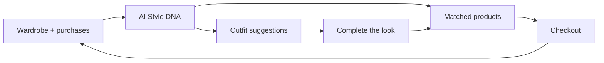

# LUKU — Pitch Deck (Slide Content)

**For:** Novastar Ventures and similar Africa-focused, impact-aligned VCs  
**Format:** Copy each `## Slide N` block into Keynote, PowerPoint, or Pitch.com  
**Last updated:** June 2026  
**Positioning:** Commerce-primary · Wardrobe + purchase AI as differentiation · Stylist as retention layer

---

## Slide 1 — Title

**LUKU**  
*Your Personal Style Companion*

**The only shop that knows your closet** — AI-matched fashion commerce for Africa’s mass market.

`[Founder name]` · `[email]` · `[date]`

---

## Slide 2 — Mission

> **We help everyday people shop smarter by matching them to fashion they will actually wear — using AI, their wardrobe, and their purchase history.**

**Primary:** Personalized commerce at high-intent moments  
**Secondary:** AI stylist + mood boards that drive daily engagement and fill wardrobe gaps

---

## Slide 3 — The Problem

**Shopping and style are disconnected — buyers and sellers both lose.**

| Pain | Today |
|------|-------|
| **Wrong purchases** | Buys don’t fit existing wardrobe or style → waste, returns, regret |
| **Generic marketplaces** | Jumia, IG shops — no idea what you already own or what matches |
| **Seller trust gap** | IG sellers: views ≠ sales; buyers distrust informal channels |
| **Decision fatigue** | 20–30 min/day choosing outfits; scattered inspiration |
| **Impulse vs. intent** | Social scroll mixes entertainment and shopping — low conversion |

**Frequency:** Daily style friction · Weekly–monthly purchase intent · **Growing** social commerce in East Africa

---

## Slide 4 — Who We Serve

**Beachhead → scale**

**Consumers (primary)**  
- 18–45, urban, mobile-first, fashion-curious  
- Want to **buy what fits** — not browse endless catalogs  
- Budget-conscious; sustainability-aware  

**Sellers & creators (supply side)**  
- IG/WhatsApp sellers seeking **conversion + trust**  
- Creators monetizing “shop the look”  

**Geography:** Kenya → Uganda, Tanzania → broader Africa

**Strategy:** Wardrobe-powered commerce niche → pan-African marketplace platform

---

## Slide 5 — Market Size

```
TAM  ─────────────────────────────────────────  Global fashion e-commerce
SAM  ────────────────────────                  Africa mobile fashion commerce
SOM  ──────────                                EAC wardrobe-aware shoppers + social sellers
```

| | |
|---|---|
| **TAM** | `[Insert $ + source]` |
| **SAM** | `[Insert $ + source]` |
| **SOM (3–5 yr)** | `[Insert $ + source]` |

**Why now:** Smartphones · M-Pesa · AI cost curves · seller fatigue with feed algorithms · demand for trusted alternatives to IG commerce

---

## Slide 6 — Solution

**LUKU: commerce powered by what you own and what you’ve bought**

### Primary — AI-matched shopping
1. **Wardrobe digitization** — AI tags what you own  
2. **Purchase history** — every buy refines your Style DNA  
3. **Personalized marketplace** — products scored 0–100% against your closet  
4. **Trusted checkout** — M-Pesa · Paystack · Stripe · verified sellers  

### Secondary — Stylist & planning (retention)
5. **AI outfit suggestions** — wear more of what you own  
6. **Mood boards** — plan looks; discover gaps to shop  
7. **Sustainability tracking** — wear logs, eco nudges, buy-smarter prompts  

`[Product screenshot: Home “Picked for You” hero · AI match % · Cart]`

---

## Slide 7 — How It Works



**Commerce loop:** Upload closet → see matched products → buy → purchase syncs wardrobe → smarter matches  
**Retention loop:** Daily outfit suggestions → identify gaps → shop only what fits

---

## Slide 8 — Innovation / Moat

**Wardrobe-native AI commerce — not another shopping feed**

| Incumbents | LUKU |
|------------|------|
| Shopping-first, no closet context | **Wardrobe + purchase history** power every recommendation |
| Generic “For You” feeds | **AI match 0–100%** vs items you own and have bought |
| Social scroll, low intent | **High-intent** at outfit-building and gap-fill moments |
| IG sellers, no infrastructure | Platform trust + discovery + payments + post-purchase sync |

**Moat:** Proprietary wardrobe + transaction graph. Every upload, purchase, wear log, and thumbs-up improves matching for consumers and sellers.

**Positioning:** We are not a styling app with a shop bolted on. We are a **commerce platform only you can personalize**.

---

## Slide 9 — Multi-Sided Platform

| Side | Primary value | Monetization |
|------|---------------|--------------|
| **Consumers** | Shop fashion matched to their closet | Free core; drives GMV |
| **Sellers** | Intent-based buyers, AI-surfaced at match moments | Take rate on GMV |
| **Creators** | Shoppable looks with affiliate earnings | Commission on tagged outfits |

**Flywheel:** More wardrobes + purchases → better AI matches → higher conversion → more sellers → richer data

**Stylist features retain users between purchases; commerce monetizes trust built over time.**

---

## Slide 10 — Business Model

**Revenue (primary)**
- Marketplace commission on GMV  
- Creator affiliate on shoppable looks  

**Revenue (future)**
- Premium AI styling, seller analytics, promoted listings  

**Unit economics**
- **CAC payback via commerce** — not ads or subscriptions alone  
- **Retention via stylist** — daily outfit loop keeps users until next purchase moment  
- **LTV grows with wardrobe depth** — more items + purchases = stickier matches  

**Risks → mitigations**
| Risk | Mitigation |
|------|------------|
| Marketplace cold start | Seed 50 anchor sellers; AI qualifies buyer intent |
| Empty wardrobe = weak shop | Onboarding: “Add 5 items → unlock your personalized shop” |
| AI cost | Server-side Gemini via BFF; task routing |
| Trust / logistics | Reviews, KYC, Terminal Africa + local couriers |
| Burn | Phased waves; commerce gates before scaling CAC |

---

## Slide 11 — Traction

**Built foundation. Executing commerce-first mobile.**

| Done | In flight |
|------|-----------|
| Web platform (commerce, AI matching, sellers) | Expo mobile v1 |
| Home: “Picked for You” + AI match % | Wardrobe upload (W3) |
| Express BFF + contracts | Cart / wishlist (W4) |
| Supabase + payment rails designed | Checkout + M-Pesa (W5) |
| Stylist tab (outfit + enhancer UX) | Stylist API live (W6) |

| Metric | Value |
|--------|-------|
| MAU | `[—]` |
| Sellers | `[—]` |
| GMV | `[—]` |
| Listing → sale conversion | `[—]` |

---

## Slide 12 — Competition

| | Marketplaces | Styling apps | Social commerce (IG) | **LUKU** |
|---|:---:|:---:|:---:|:---:|
| Wardrobe-aware recommendations | — | partial | — | ✓ |
| Purchase history in matching | partial | — | — | ✓ |
| AI match score on products | — | — | — | ✓ |
| Marketplace + M-Pesa checkout | ✓ | — | partial | ✓ |
| Daily outfit / stylist retention | — | ✓ | — | ✓ |
| Seller platform + trust | partial | — | — | ✓ |

**Position:** The only wardrobe- and purchase-aware commerce platform built for East Africa’s mass market — not a styling toy, not a generic marketplace.

---

## Slide 13 — Go-to-Market

**Phase 1 — Kenya launch (commerce-first)**

**Consumers**
- Onboarding: upload 5 wardrobe items → unlock personalized shop  
- Activation: first AI-matched product view → first add-to-cart → first purchase  
- Retention: daily outfit suggestions → “complete the look” commerce moments  

**Sellers**
- IG/WhatsApp seller outreach: “On IG you get likes; on LUKU you get add-to-cart”  
- Anchor cohort: 50 sellers with intent-qualified buyer traffic  

**Phase 2 — EAC** · Uganda, Tanzania · localized payments + delivery  
**Phase 3 — Pan-African** · Nigeria, Rwanda, South Africa  

**North star metrics (in order):** First purchase · Listing → sale conversion · Repeat buyer rate · Wardrobe depth · D7 retention

---

## Slide 14 — Team

`[Photo grid: founders]`

| | |
|---|---|
| **`[CEO]`** | `[Credential line]` |
| **`[CTO]`** | `[Credential line]` |
| **`[Product/Growth]`** | `[Credential line]` |

**Why us**
- Africa market fluency: M-Pesa, KES/UGX/TZS, social-seller workflows  
- Commerce + AI builders: BFF, mobile, wardrobe graph, payments  
- Disciplined execution: phase gates, wave delivery, falsifiable milestones  

---

## Slide 15 — Capital Efficiency

**Lean paths. Commerce proof before scale.**

| Principle | Practice |
|-----------|----------|
| Cut the fat | Server-side AI only; stylist API deferred to W6 |
| Fail fast, small | Test seller conversion + checkout E2E before paid acquisition |
| Fundamentals first | GMV, take rate, repeat purchase — not vanity DAU |
| Full-stack | Own broken chain: match → trust → pay → wardrobe sync |

**Kill criteria (pre-scale):** Checkout E2E + 50 sellers live + listing→sale conversion `[X]%` — or narrow geo before burning CAC

---

## Slide 16 — Roadmap & Milestones

| When | Milestone | Assumption tested | Capital |
|------|-----------|-------------------|---------|
| Q2 2026 | Mobile v1: auth, catalog, AI-matched Home | Users engage with personalized shop | Seed |
| Q3 2026 | Wardrobe upload + cart + sell flow | Closet data improves match quality; sellers list | Seed |
| Q4 2026 | Checkout + M-Pesa; 50 sellers; paid orders | **Commerce conversion in Kenya** | Seed |
| Q1 2027 | Stylist API live; outfit → shop gaps | Retention between purchases | Seed / bridge |
| 2027 | 1,000 sellers; repeat buyers | Network effects + GMV density | Series A |
| 2028+ | EAC + Nigeria expansion | Pan-African unit economics | Series A+ |

See `FINANCIAL_TEMPLATE.md` for detailed use-of-funds.

---

## Slide 17 — Vision (5–10 years)

**The trusted commerce layer for fashion in emerging markets**

- **100M+ wardrobes + purchase histories** powering the most accurate fashion matching engine in Africa  
- **Default shop** for independent sellers, creators, and brands — intent-qualified, not algorithm-dependent  
- **Stylist layer** keeps users engaged between purchases; commerce captures value at the right moment  
- **Planet-positive:** wear-more, buy-smarter — measurable reduction in impulse waste  

*7am Nairobi: open LUKU → see a 94% match trench coat → pay with M-Pesa → item syncs to wardrobe → AI refines tomorrow’s outfit.*

---

## Slide 18 — Exit Strategy

**Patient capital. Multiple paths.**

| Path | Examples |
|------|----------|
| Strategic M&A | Global fashion/marketplace · telco · fintech · retail |
| Growth equity | At proven GMV + repeat purchase rate |
| IPO (long-term) | At Africa-scale marketplace GMV |

Built for **7–10 year enduring value** — a commerce platform with a data moat, not a feature app.

---

## Slide 19 — The Ask

**Raising `[ $X ]` seed**

| Use | % |
|-----|---|
| Product & engineering (commerce + wardrobe + checkout) | 50% |
| Seller acquisition (Kenya) | 25% |
| AI / infra / ops | 15% |
| Contingency | 10% |

**This round proves:** Mobile commerce E2E · 50 anchor sellers · first paid orders · listing→sale conversion · unit economics in Kenya

**Ideal partner:** Mass-market Africa · people + planet · disciplined capital · full-stack builders

---

## Slide 20 — Thank You / Contact

**LUKU** — Your Personal Style Companion

*Shop fashion matched to your closet.*

`[Founder Name]`  
`[email]` · `[phone]` · `[LinkedIn]`  
`[Deck link]` · `[Demo / Calendly]`

*Let's build enduring value for people and planet — one personalized purchase at a time.*

---

## Appendix (optional slides)

- **A1:** Product screenshots (**Home “Picked for You”**, Product detail + match %, Checkout, Cart — then Stylist, Mood board)  
- **A2:** User journey: wardrobe upload → match → purchase → sync → better matches  
- **A3:** Architecture diagram (Mobile → BFF → Supabase; no client secrets)  
- **A4:** Seller pain → LUKU value table (from `SELLER_ACQUISITION_BRAINSTORM.md`)  
- **A5:** Financial model summary (`FINANCIAL_TEMPLATE.md`)  
- **A6:** Cap table / prior funding (if applicable)
